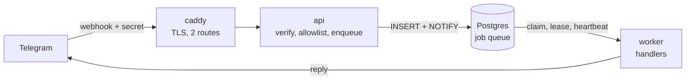

# Dzdia Newsroom Engine

[](https://github.com/Mounso/dzdia-newsroom/actions/workflows/ci.yml)


AI assistant for the editorial team of [dzdia.com](https://dzdia.com), an Algerian cultural media. Journalists talk to it on Telegram. It is designed to turn a link, an audio or a video into a sourced article draft, and to post a daily briefing of web and social news. Every fact will cite its evidence, and nothing will reach WordPress without human approval.

> **Status: week 1 of 5.** The runtime foundation is built and tested end to end with a real bot: Telegram webhook, Postgres job queue, worker, Docker stack. The hallucination baseline of the legacy bot is in progress. AI flows start in week 2. See the [roadmap](docs/roadmap.md).

## Why

The prototype this project replaces ("v1") never downloaded the links it was given: the model wrote articles from the words of the URL alone. Rather than just fix it, the rewrite starts by **measuring** it: a [hallucination baseline](docs/evals/baseline-v1.md) on 20 real articles, with human labels and confidence intervals, that will be rerun on v2 for a like-for-like comparison.

## Architecture at a glance



- **The webhook acknowledges immediately.** All work goes through a Postgres queue with at-least-once delivery: `SKIP LOCKED` claims, leases renewed by heartbeat, fencing tokens, full-jitter retries and a dead-letter state. [More](docs/architecture/job-queue.md)
- **Least privilege by construction.** Each process loads only its own settings; the API never sees the bot token. A fail-closed allowlist gates every message. [More](docs/architecture/security.md)
- **No framework owns the control flow.** No Celery, no bot framework, no agent framework: small, typed, tested modules.
- **Every structural choice is recorded** in an [architecture decision record](docs/adr/README.md), with the alternatives that were rejected.

Full picture: [architecture overview](docs/architecture/overview.md).

## Tech stack

Python 3.12 (async, mypy strict, Pydantic v2) · FastAPI · psycopg 3 and raw SQL · Postgres 16 with pgvector · httpx · Google Gemini · Docker Compose · Caddy · GitHub Actions · uv, ruff, pytest.

## Quick start

Requirements: [uv](https://docs.astral.sh/uv/) and Docker. On Windows, Docker Desktop with WSL 2.

```bash
uv sync
cp .env.example .env        # then fill it in: see docs/operations/configuration.md
uv run pytest -q && uv run mypy && uv run ruff check .
```

Run the whole stack locally, with a public HTTPS tunnel for the Telegram webhook:

```bash
docker compose --profile dev up -d --build
docker compose logs cloudflared           # read the https://<random>.trycloudflare.com URL
docker compose run --rm telegram-cli set-webhook --url https://<random>.trycloudflare.com/webhooks/telegram
```

Details: [getting started](docs/development/getting-started.md) and [deployment](docs/operations/deployment.md).

## Repository layout

```text
src/dzdia_newsroom/   application: api/, channels/, db/, worker/, config, logging
evals/                evaluation harnesses (baseline_v1) and committed datasets
tests/                unit tests and Postgres integration tests
docs/                 architecture, ADRs, operations, development, evals
```

## Documentation

| Understand | Operate | Develop |
|---|---|---|
| [Architecture overview](docs/architecture/overview.md) | [Configuration](docs/operations/configuration.md) | [Getting started](docs/development/getting-started.md) |
| [Job queue](docs/architecture/job-queue.md) | [Deployment](docs/operations/deployment.md) | [Testing](docs/development/testing.md) |
| [Security](docs/architecture/security.md) | [Runbook](docs/operations/runbook.md) | [Conventions](docs/development/conventions.md) |
| [Decisions (ADRs)](docs/adr/README.md) | [Design review](docs/reviews/2026-10-28-design-review.md) | [Baseline v1 eval](docs/evals/baseline-v1.md) |

Article snapshots and raw model outputs are copyrighted or derived from copyrighted text: they stay in `evals/.data/`, outside Git and outside Docker images.
