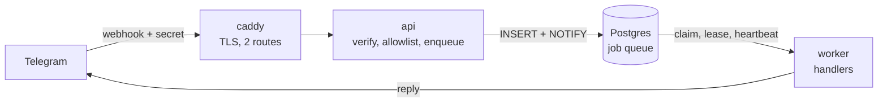

# Dzdia Newsroom Engine

[](https://github.com/Mounso/dzdia-newsroom/actions/workflows/ci.yml)


AI assistant for the editorial team of [dzdia.com](https://dzdia.com), an Algerian cultural media. Journalists talk to it on Telegram. It is designed to turn a link, an audio or a video into a sourced article draft, and to post a daily briefing of web and social news. Every fact will cite its evidence, and nothing will reach WordPress without human approval.

> **Status (2026-11-15): stage 2 of 3.** The runtime foundation is built and tested end to end with a real bot: Telegram webhook, Postgres job queue, worker, Docker stack. The hallucination baseline of the legacy bot is done. The first slice of the rewrite, one link in and one sourced article out, has its evidence, generation and validation code and was measured offline against the legacy prompt; page fetching and the Telegram wiring of that slice are written and tested without the network or a real model, but the chain has not run end to end with a real bot yet. See the [roadmap](docs/roadmap.md).

## Why

The prototype this project replaces ("v1") never downloaded the links it was given: the model wrote articles from the words of the URL alone. Rather than just fix it, the rewrite starts by **measuring** it: a [hallucination baseline](docs/evals/baseline-v1.md) on 16 real news articles, with human labels and confidence intervals, then the [same protocol on the rewrite](docs/evals/v2-comparison.md).

## What was measured

Share of the checkable elements of a generated article (persons, organizations, places, numbers, dates, quotes) that the source does not support, on the same 16 articles, with the same model. Every element is labeled by hand; the intervals are 95 % intervals from a bootstrap over articles.

| What the model gets | Unsupported elements | Articles with at least one |
|---|---|---|
| v1 prompt, the URL only (v1 as shipped) | 57 % [48–67 %] (72/126) | 15 of 16 |
| v1 prompt, the page text | 12.9 % [8.5–18.1 %] (33/256) | 15 of 16 |
| A plain new prompt, the page text | 0.0 % (0/227) | 0 of 16 |
| v2: evidence ids, structured output, validator | 2.6 % [0.0–6.3 %] (5/194) | 3 of 16 |

- **From the URL alone, more than half of what a v1 article states is unsupported.** Given the page text, the old prompt still leaves about one element in eight unsupported, in articles that state twice as many elements.
- **The gain of the rewrite comes from its prompt, not from its architecture**: on this metric a plain prompt with the same instructions does as well as v2. The comparison was designed to be able to say so, with its conclusion wording fixed before the labels.
- **Limits:** 16 articles from two outlets on one day, one labeler, general news rather than the outlet's own cultural content. The first row was not labeled blind; the two new arms and most of the second row were. Zero observed is not zero: with 0 articles of 16, up to about 17 % of articles could still contain an unsupported element.

Details, method and limits: [baseline](docs/evals/baseline-v1.md#results) and [v2 comparison](docs/evals/v2-comparison.md#labels-and-report-2026-11-14).

## Architecture at a glance



- **The webhook acknowledges immediately.** All work goes through a Postgres queue with at-least-once delivery: `SKIP LOCKED` claims, leases renewed by heartbeat, fencing tokens, full-jitter retries and a dead-letter state. [More](docs/architecture/job-queue.md)
- **Least privilege by construction.** Each process loads only its own settings; the API never sees the bot token. A fail-closed allowlist gates every message. [More](docs/architecture/security.md)
- **No framework owns the control flow.** No Celery, no bot framework, no agent framework: small, typed, tested modules.
- **Every structural choice is recorded** in an [architecture decision record](docs/adr/README.md), with the alternatives that were rejected.

Full picture: [architecture overview](docs/architecture/overview.md).

## Tech stack

Python 3.12 (async, mypy strict, Pydantic v2) · FastAPI · psycopg 3 and raw SQL · Postgres 16 with pgvector · httpx · Google Gemini · Docker Compose · Caddy · GitHub Actions · uv, ruff, pytest.

## Quick start

Requirements: [uv](https://docs.astral.sh/uv/) and Docker. On Windows, Docker Desktop with WSL 2.

```bash
uv sync
cp .env.example .env        # then fill it in: see docs/operations/configuration.md
uv run pytest -q && uv run mypy && uv run ruff check .
```

Run the whole stack locally, with a public HTTPS tunnel for the Telegram webhook:

```bash
docker compose --profile dev up -d --build
docker compose logs cloudflared           # read the https://<random>.trycloudflare.com URL
docker compose run --rm telegram-cli set-webhook --url https://<random>.trycloudflare.com/webhooks/telegram
```

Details: [getting started](docs/development/getting-started.md) and [deployment](docs/operations/deployment.md).

## Repository layout

```text
src/dzdia_newsroom/   application: api/, channels/, db/, worker/, llm/, tools/, config, logging
evals/                evaluation harnesses (baseline_v1, v2, dzdia_corpus) and committed datasets
tests/                unit tests and Postgres integration tests
deploy/               production VM: provisioning, deployment and rollback, encrypted backups
docs/                 architecture, ADRs, operations, development, evals
```

## Documentation

| Understand | Operate | Develop |
|---|---|---|
| [Architecture overview](docs/architecture/overview.md) | [Configuration](docs/operations/configuration.md) | [Getting started](docs/development/getting-started.md) |
| [Job queue](docs/architecture/job-queue.md) | [Deployment](docs/operations/deployment.md) | [Testing](docs/development/testing.md) |
| [Security](docs/architecture/security.md) | [Runbook](docs/operations/runbook.md) | [Conventions](docs/development/conventions.md) |
| [Decisions (ADRs)](docs/adr/README.md) | [Design review](docs/reviews/2026-10-28-design-review.md) | [Baseline v1 eval](docs/evals/baseline-v1.md) |

Article snapshots and raw model outputs are copyrighted or derived from copyrighted text: they stay in `evals/.data/`, outside Git and outside Docker images.
