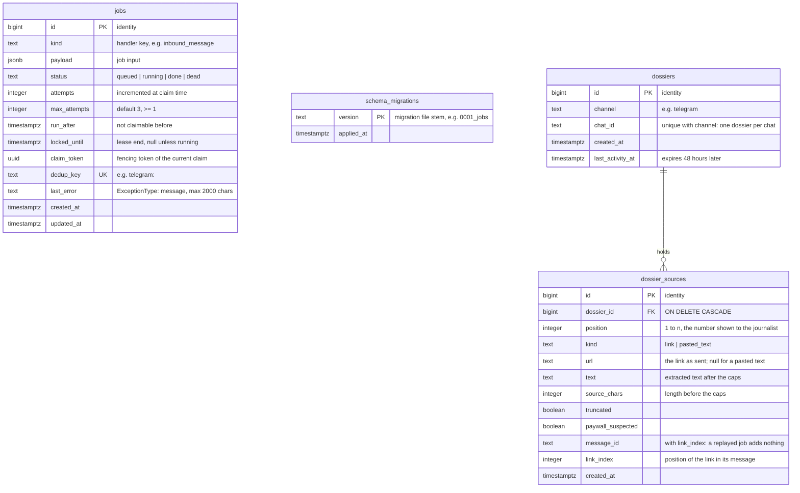

# Data model

Postgres is the system's single source of truth. This document lists the tables that exist, the payload formats stored in them, and the tables planned for later weeks. Schema changes go through numbered SQL migrations (see [conventions](../development/conventions.md)).

## Current schema

### `jobs`

Defined in [`0001_jobs.sql`](../../src/dzdia_newsroom/db/migrations/0001_jobs.sql). The meaning of each state and transition is in [Job queue](job-queue.md#job-lifecycle).

| Index | Columns | Serves |
|---|---|---|
| `jobs_pkey` | `id` | Fenced updates (`WHERE id = … AND claim_token = …`). |
| `jobs_dedup_key_key` (unique) | `dedup_key` | Deduplication on enqueue. `NULL` keys never conflict. |
| `jobs_queued_idx` (partial) | `(run_after, id) WHERE status = 'queued'` | Claiming ready jobs in order. |
| `jobs_running_idx` (partial) | `locked_until WHERE status = 'running'` | Finding expired leases. |

Partial indexes stay small: they only contain the rows a worker may claim, not the growing history of `done` jobs.

### `schema_migrations`

Created by the migration runner itself ([`db/migrate.py`](../../src/dzdia_newsroom/db/migrate.py)). One row per applied file. The runner holds a Postgres advisory lock while it works, so two concurrent runs apply each file once.

### `dossiers` and `dossier_sources`

Defined in [`0002_dossiers.sql`](../../src/dzdia_newsroom/db/migrations/0002_dossiers.sql) ([ADR-0020](../adr/0020-source-dossier-in-private-chat.md)). A private chat has at most one dossier; each web page or pasted text that a journalist sends becomes one source of it.

- Only extracted text is stored: no HTML, no draft, no article and no evidence item. Evidence is rebuilt from the stored texts each time an article is written.
- Adding a source is one transaction that locks the dossier row, checks the caps (6 sources, 30,000 characters per source, 60,000 per dossier) and inserts at the next position.
- The unique key on `(dossier_id, message_id, link_index)` makes a replayed job add nothing.
- `/nouveau` deletes the dossier row, and its sources with it.

## Job payloads

| `kind` | Payload | Producer | Consumer |
|---|---|---|---|
| `inbound_message` | A serialized `InboundMessage` | `api` webhook | `worker/handlers.py` |

`InboundMessage` ([`channels/base.py`](../../src/dzdia_newsroom/channels/base.py)):

| Field | Type | Notes |
|---|---|---|
| `channel` | `"telegram"` | Platform the message came from. |
| `event_id` | string | Platform delivery id (Telegram `update_id`); source of the dedup key. |
| `chat_id`, `user_id`, `message_id` | string | Strings, so no platform id format is assumed. |
| `is_private` | bool | One-to-one chat with the bot, as opposed to a group. |
| `text` | string | Message text. Personal data: never logged. |
| `sent_at` | datetime (UTC) | Telegram `message.date`. |
| `raw` | object | The original update, for debugging and replay only. The worker must not read it. |

Payloads are validated again by the handler (`InboundMessage.model_validate`); an invalid payload is a permanent error.

## Retention

A background task of the worker runs at start and then every hour ([ADR-0020](../adr/0020-source-dossier-in-private-chat.md), points 7 and 8).

| Data | Rule |
|---|---|
| A dossier and its sources | Deleted 48 hours after the last activity (a source added, or an article written). Every read also deletes an expired dossier first, so the rule does not depend on when the task runs. |
| The payload of an `inbound_message` job | Replaced by `{}` once the job is `done` or `dead` and has not changed for 48 hours. The row and its `dedup_key` stay, so a redelivered update is still refused. |

Rows of `jobs` are still never deleted (the rest of gap R4 in the [design review](../reviews/2026-10-28-design-review.md)). A `dead` job cannot be replayed by hand once its payload is emptied.

## Planned tables

From the product spec; each will be designed in its own ADR.

| Table | Purpose | Week |
|---|---|---|
| `workflows` | Approval state machine of an article (`APPROVED` required before any WordPress write), with who approved and when. | 2 |
| `evidences` | Source passages with stable ids, cited by model outputs; built by code, never by the model. | 2 |
| `audit_logs` | Every tool call: tool, arguments, user, result, cost. | 2-4 |
| Archive chunks | dzdia.com articles split into paragraphs, with embeddings (pgvector) and full-text vectors (`tsvector`, `french` configuration) for hybrid search. | 3 |
