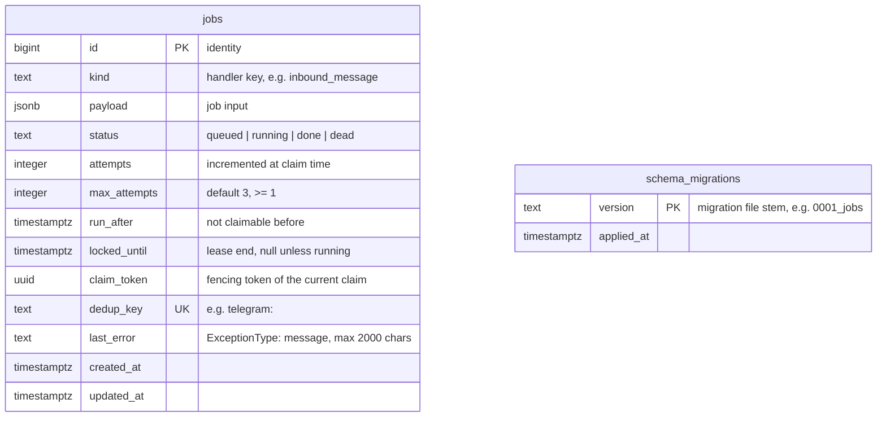

# Data model

Postgres is the system's single source of truth. This document lists the tables that exist, the payload formats stored in them, and the tables planned for later weeks. Schema changes go through numbered SQL migrations (see [conventions](../development/conventions.md)).

## Current schema

### `jobs`

Defined in [`0001_jobs.sql`](../../src/dzdia_newsroom/db/migrations/0001_jobs.sql). The meaning of each state and transition is in [Job queue](job-queue.md#job-lifecycle).

| Index | Columns | Serves |
|---|---|---|
| `jobs_pkey` | `id` | Fenced updates (`WHERE id = … AND claim_token = …`). |
| `jobs_dedup_key_key` (unique) | `dedup_key` | Deduplication on enqueue. `NULL` keys never conflict. |
| `jobs_queued_idx` (partial) | `(run_after, id) WHERE status = 'queued'` | Claiming ready jobs in order. |
| `jobs_running_idx` (partial) | `locked_until WHERE status = 'running'` | Finding expired leases. |

Partial indexes stay small: they only contain the rows a worker may claim, not the growing history of `done` jobs.

### `schema_migrations`

Created by the migration runner itself ([`db/migrate.py`](../../src/dzdia_newsroom/db/migrate.py)). One row per applied file. The runner holds a Postgres advisory lock while it works, so two concurrent runs apply each file once.

## Job payloads

| `kind` | Payload | Producer | Consumer |
|---|---|---|---|
| `inbound_message` | A serialized `InboundMessage` | `api` webhook | `worker/handlers.py` |

`InboundMessage` ([`channels/base.py`](../../src/dzdia_newsroom/channels/base.py)):

| Field | Type | Notes |
|---|---|---|
| `channel` | `"telegram"` | Platform the message came from. |
| `event_id` | string | Platform delivery id (Telegram `update_id`); source of the dedup key. |
| `chat_id`, `user_id`, `message_id` | string | Strings, so no platform id format is assumed. |
| `is_private` | bool | One-to-one chat with the bot, as opposed to a group. |
| `text` | string | Message text. Personal data: never logged. |
| `sent_at` | datetime (UTC) | Telegram `message.date`. |
| `raw` | object | The original update, for debugging and replay only. The worker must not read it. |

Payloads are validated again by the handler (`InboundMessage.model_validate`); an invalid payload is a permanent error.

## Retention

None yet: rows are never deleted. Planned (gap R4 in the [design review](../reviews/2026-10-28-design-review.md)): purge `done` jobs after a fixed period, and minimize or purge `raw` earlier. Any purge must keep `dedup_key` rows for at least 24 hours, the window during which Telegram may redeliver an update.

## Planned tables

From the product spec; each will be designed in its own ADR.

| Table | Purpose | Week |
|---|---|---|
| `workflows` | Approval state machine of an article (`APPROVED` required before any WordPress write), with who approved and when. | 2 |
| `evidences` | Source passages with stable ids, cited by model outputs; built by code, never by the model. | 2 |
| `audit_logs` | Every tool call: tool, arguments, user, result, cost. | 2-4 |
| Archive chunks | dzdia.com articles split into paragraphs, with embeddings (pgvector) and full-text vectors (`tsvector`, `french` configuration) for hybrid search. | 3 |
