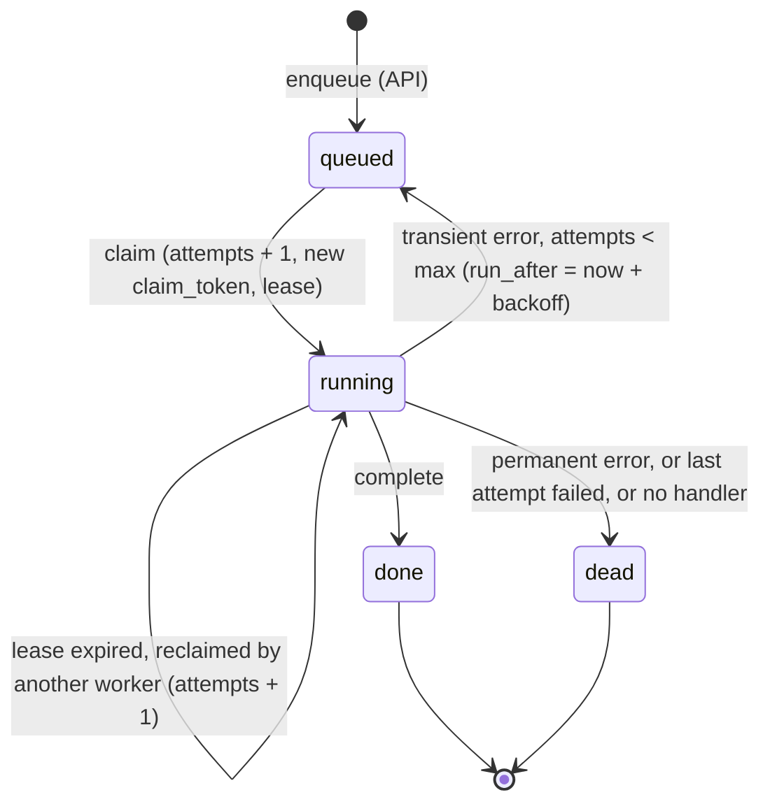
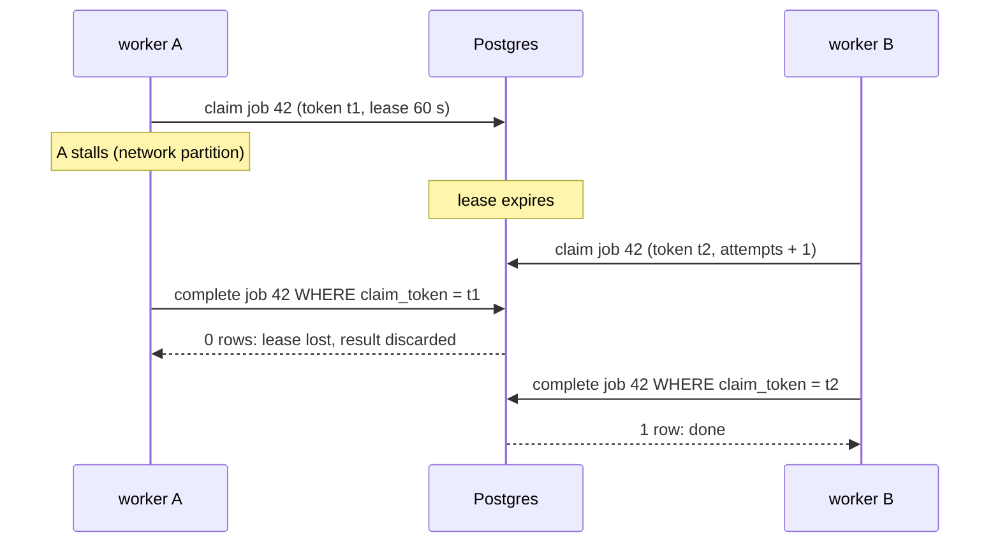

# Job queue

The job queue decouples the webhook from the work and makes the work survive crashes, restarts and provider outages. It is about 300 lines of Python and SQL on top of Postgres, with no broker. This document describes its guarantees and how they are achieved. The decision to build it rather than use Celery, RQ, procrastinate or pgqueuer is recorded in [ADR-0004](../adr/0004-runtime-foundation.md).

Code: [`worker/queue.py`](../../src/dzdia_newsroom/worker/queue.py), [`db/repository.py`](../../src/dzdia_newsroom/db/repository.py), [`db/migrations/0001_jobs.sql`](../../src/dzdia_newsroom/db/migrations/0001_jobs.sql).

## Guarantees

| Property | Guarantee | Mechanism |
|---|---|---|
| Durability | An acknowledged webhook is never lost. | The API answers 200 only after the `INSERT` commits; any error returns 500 and Telegram resends. |
| No duplicate jobs | A redelivered update creates no second job. | `dedup_key = 'telegram:<update_id>'`, unique, `ON CONFLICT DO NOTHING`. |
| Mutual exclusion | At most one worker *owns* a job at a time. | `FOR UPDATE SKIP LOCKED` at claim time, then a lease (`locked_until`). |
| Crash recovery | A job whose worker died is picked up again. | An expired lease makes the job claimable again. |
| Fencing | A worker that lost its lease can no longer change the job. | Every update after the claim requires the `claim_token` drawn at that claim. |
| Bounded retries | A failing job is retried with backoff, then buried. | `attempts` vs `max_attempts`, full-jitter exponential backoff, `dead` status. |
| Delivery | **At least once**, not exactly once. | A handler may run twice (worker dies after the side effect, before `complete`). Handlers must be idempotent or record their effects. |

## Job lifecycle



`attempts` is incremented **at claim time**, not on failure. A job that crashes its worker (or is cancelled at shutdown) therefore still consumes attempts, and cannot loop forever. When a job is reclaimed after its last attempt (`attempts > max_attempts`), the worker marks it `dead` without running it.

## Claiming a job

```sql
UPDATE jobs
SET status = 'running',
    attempts = attempts + 1,
    claim_token = gen_random_uuid(),
    locked_until = now() + %(lease_s)s * interval '1 second',
    updated_at = now()
WHERE id = (
    SELECT id FROM jobs
    WHERE (status = 'queued' AND run_after <= now())
       OR (status = 'running' AND locked_until < now())   -- lease expired: worker presumed dead
    ORDER BY run_after, id
    FOR UPDATE SKIP LOCKED
    LIMIT 1
)
RETURNING id, kind, payload, attempts, max_attempts, claim_token
```

- One statement, in autocommit: the row lock lives only for the duration of the `UPDATE`. No connection or transaction stays open while the handler runs; ownership is carried by the lease and the token instead. Holding a transaction open for a multi-minute LLM call was rejected in ADR-0004.
- `SKIP LOCKED` lets several workers claim concurrently without blocking each other; each gets a different row (covered by `test_concurrent_claims_get_distinct_jobs`).
- Two partial indexes keep the two branches cheap: `(run_after, id) WHERE status = 'queued'` and `(locked_until) WHERE status = 'running'`.

## Lease, heartbeat and fencing

| Setting (`WorkerConfig`) | Default | Meaning |
|---|---|---|
| `lease_s` | 60 s | How long a claim stays valid without renewal. |
| `heartbeat_s` | 20 s | Renewal period while the handler runs; must be shorter than `lease_s` (two beats can be missed). |
| `poll_s` | 5 s | Fallback wake-up period when no `NOTIFY` arrives. |
| `retry_base_s`, `retry_cap_s` | 5 s, 300 s | Backoff parameters. |

The handler runs in its own task. The worker waits for it in slices of `heartbeat_s` and extends the lease between slices. If the extension fails (another worker reclaimed the job), the handler is cancelled and its result discarded.

The lease alone is not enough: a worker paused by a long GC, a network partition or a suspended VM can wake up after its lease expired and another worker took over. The **claim token** fences it out: every `UPDATE` after the claim includes `WHERE id = … AND claim_token = … AND status = 'running'`, so the stale worker's `complete`, `retry_later` or `mark_dead` matches no row and returns `False`.



**Limit of fencing.** The token protects the database row, not the outside world: if worker A had already sent a Telegram message or created a WordPress draft, that side effect happened. This is why delivery is at least once and why handlers with external side effects need an idempotency record (planned with the WordPress tool, see the [design review](../reviews/2026-10-28-design-review.md#4-architecture-assessment)).

## Waking up workers

- `enqueue` runs `pg_notify('jobs', kind)` in the same transaction as the `INSERT`. Postgres delivers notifications at commit, so a woken worker always sees the new row.
- Each worker keeps one dedicated `LISTEN jobs` connection (`listen_for_jobs`), separate from the pool, and reconnects with exponential backoff (1 s to 60 s) if it drops. It sets the wake event after each reconnection, since jobs may have been enqueued meanwhile.
- The worker clears the wake event **before** draining the queue, so a notification that arrives during the drain is not lost.
- Polling every `poll_s` covers any missed notification. `NOTIFY` only lowers latency; correctness never depends on it.

## Retries and error taxonomy

| Raised by the handler | Outcome |
|---|---|
| `PermanentJobError` (invalid payload, request rejected by the platform) | `dead` immediately, no retry. |
| Any other exception, `attempts < max_attempts` | `queued` again, `run_after = now() + delay`. |
| Any other exception on the last attempt | `dead`, with the error in `last_error`. |
| Unknown `kind` | `dead`. |

The delay uses **full jitter**: `uniform(0, min(cap, base * 2^(attempts - 1)))`. Jobs that fail together during a provider outage come back spread out instead of in a synchronized burst.

The Telegram client adds a second, inner retry layer for short failures (network errors, 5xx, 429 with `retry_after` up to 30 s). Longer failures are raised as `ChannelError` and left to the queue; rejections (other 4xx) become `PermanentChannelError`, which the handler turns into `PermanentJobError`.

`last_error` stores `ExceptionType: message`, truncated to 2000 characters. Errors built from user input (for example a pydantic validation error on the payload) are reduced to a count, so message text never lands in the table.

## Graceful shutdown

On `SIGTERM` (`docker compose stop`) or `SIGINT`, the worker stops claiming, lets the current job finish for up to 25 s, then cancels it. Compose waits 30 s (`stop_grace_period`) before `SIGKILL`. A cancelled job keeps status `running` until its lease expires (at most 60 s), then another worker reclaims it.

## Known limitations

Tracked in the [design review](../reviews/2026-10-28-design-review.md):

- One job at a time per worker process; long LLM jobs will need concurrent slots (R6).
- A long Telegram `retry_after` is not carried to the queue's backoff, so a rate-limited job can exhaust its attempts (B1).
- A job cancelled at shutdown consumes an attempt and waits for its lease to expire (R1).
- No retention: `done` jobs, with message text, stay forever (R4).
- A `dead` job notifies nobody (R5).

## Operating the queue

Ready-to-run SQL for queue depth, stuck leases, dead jobs and requeueing is in the [runbook](../operations/runbook.md).
