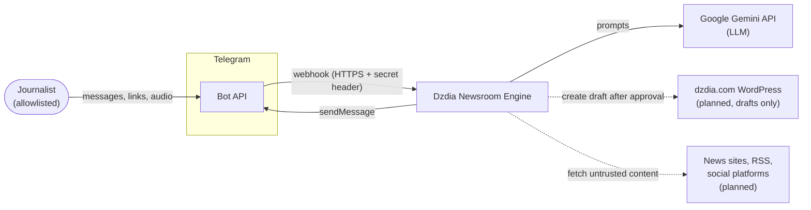
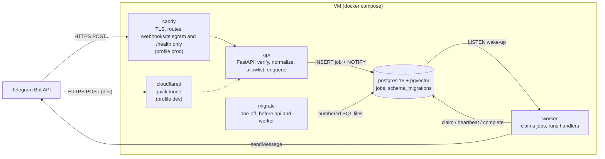
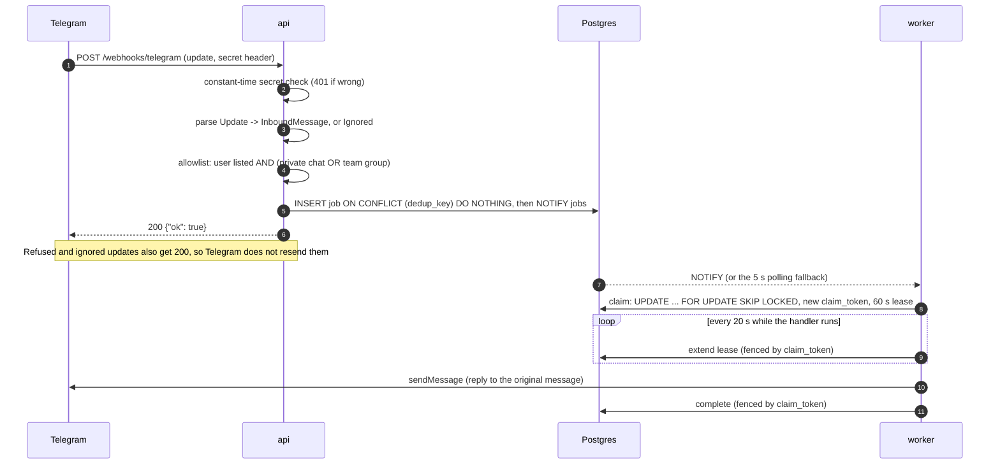
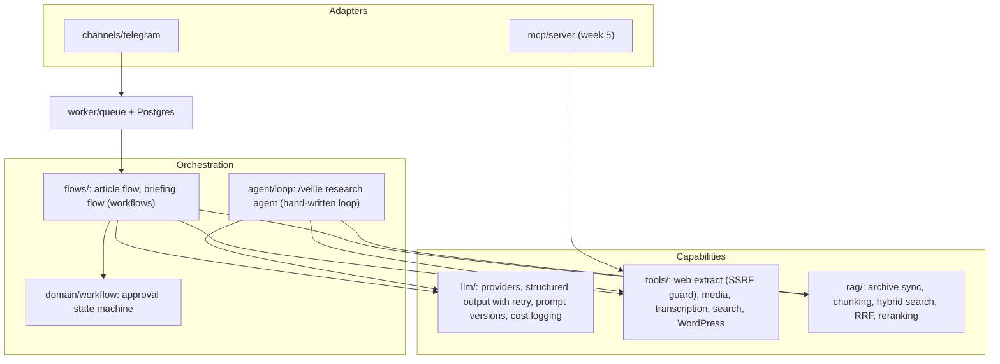

# Architecture overview

This document explains how Dzdia Newsroom Engine is built today, why it is built that way, and where it is heading. It is the entry point to the architecture documentation; deep dives live next to it and every significant decision has an [ADR](../adr/README.md).

- [Job queue](job-queue.md): delivery guarantees, leases, fencing, retries.
- [Data model](data-model.md): tables, payloads and retention.
- [Security](security.md): threat model, trust boundaries and secrets.

## Purpose and scope

Dzdia Newsroom Engine is an AI assistant for the editorial team of [dzdia.com](https://dzdia.com), a small Algerian cultural media (fewer than ten journalists). It replaces a prototype bot (`dzdia-bot`, "v1") whose main flaw was measured before any rewrite: v1 never downloaded the links it was given, so the model wrote articles from the words of the URL alone.

The target product has two confirmed use cases:

1. **Article from source material.** A journalist sends a link, an audio or a video; the system extracts the facts, proposes angles, drafts an article whose every fact cites its evidence, and creates a WordPress draft only after human approval.
2. **Morning briefing.** A scheduled workflow collects press and social sources, deduplicates and triages topics, and posts a briefing to the team's Telegram group.

**Current state (end of week 1):** the runtime foundation is built and tested end to end: Telegram webhook, Postgres job queue, worker, Docker stack. The hallucination baseline of v1 is in progress. The AI flows start in week 2. See the [roadmap](../roadmap.md).

## System context



Dashed arrows are planned. Today the only external systems in production code are Telegram and, in the evaluation harness, Gemini.

## Containers

One Docker image runs three roles (`api`, `worker`, `migrate`); compose adds Postgres and an HTTPS entry point. Details: [ADR-0004](../adr/0004-runtime-foundation.md), [ADR-0006](../adr/0006-docker-image-and-compose.md).



| Container | Responsibility | Secrets it receives |
|---|---|---|
| `api` | Accept Telegram updates, check the secret header, normalize, apply the allowlist, enqueue. Nothing else. | Webhook secret, database URL |
| `worker` | Claim jobs, renew their lease, run handlers, retry or bury failures. | Bot token, database URL |
| `migrate` | Apply pending SQL migrations under an advisory lock, then exit. `api` and `worker` start only if it succeeds. | Database URL |
| `postgres` | Single source of truth: job queue today, workflows, evidence and RAG index later. | Its own password |
| `caddy` (prod) | Only public entry point; Let's Encrypt certificates; 404 for any other route; 1 MB body limit. | None |
| `cloudflared` (dev) | Temporary public HTTPS URL for the local stack. | None |
| `telegram-cli` (tools) | One-off `set-webhook` and `webhook-info` commands. | Bot token, webhook secret |

## Request lifecycle

A text message from an allowlisted journalist, from Telegram to the reply:



Why it is split this way:

- **The webhook acknowledges immediately.** LLM calls take seconds to minutes (up to 88 s measured), longer than Telegram is willing to wait. Doing the work in the request would also make Telegram resend the update.
- **The queue is the boundary between untrusted input and work.** Everything after step 5 runs in the worker, with retries, a lease and a dead-letter state. A crash at any point loses nothing: the job either was not inserted (Telegram resends, the dedup key absorbs it) or is in Postgres.
- **Delivery is at least once.** A handler can run twice for the same job, so handlers must be idempotent or record their side effects. See [Job queue](job-queue.md#guarantees).

## Code organization

```text
src/dzdia_newsroom/
├── api/          FastAPI app: webhook route, health probe, entry point
├── channels/     Channel protocol, InboundMessage, Telegram adapter (parse + Bot API client + CLI)
├── db/           connection pool, migrations runner and SQL files, JobRepository, row models
├── worker/       queue engine (Worker, retries, heartbeat, LISTEN), job handlers, entry point
├── config.py     typed settings, one class per process role (least privilege)
├── logging_setup.py   JSON log formatter
└── runtime.py    event loop selection (Windows)
evals/baseline_v1/     hallucination baseline of v1 (offline pipeline, see docs/evals)
```

Dependency rules, enforced by review and visible in the imports:

- **Adapters depend on the core, never the reverse.** The worker only knows the `Channel` protocol and `InboundMessage`; it never sees a Telegram `Update`. A second channel (WhatsApp, web UI) only has to produce an `InboundMessage`.
- **The queue engine depends on a protocol, not on Postgres.** `Worker` takes a `JobStore`; `JobRepository` implements it. Unit tests use an in-memory store; integration tests use a real Postgres.
- **Settings are split by process.** Each entry point loads only the settings class it needs, so the API process cannot read the bot token even by mistake.
- **No framework owns the control flow.** No Celery, no bot framework, no agent framework: the queue, the Telegram client and (later) the agent loop are small, explicit and tested modules.

## Architectural invariants

These rules hold across the codebase. Some are enforced today; the others are constraints on the modules still to be written.

| Invariant | Status |
|---|---|
| Webhooks acknowledge immediately; work goes through the Postgres job queue. | Enforced |
| Secrets are distributed per process; the API never holds the bot token. | Enforced |
| Messages sent to Telegram are plain text: no `parse_mode`, so model output can never break or inject markup. | Enforced |
| Logs never contain secrets or message text. | Enforced (token redaction, `httpx` logs silenced, payload values kept out of errors) |
| The LLM never produces URLs, ids or trust scores: it cites ids it was given; code resolves and validates them. | Planned (week 2, structured outputs) |
| External content (web, social, transcripts) is untrusted: delimited in prompts, never able to trigger write tools. | Planned (week 2-4) |
| Any write tool (WordPress) requires a persisted `APPROVED` workflow state. | Planned (week 2) |
| Tools live in `tools/`; Telegram and MCP are thin adapters over them. | Planned |

## Quality attributes

| Attribute | How the current design addresses it |
|---|---|
| Reliability | Persistent queue with leases renewed by heartbeat; fencing tokens; full-jitter retries; dead-letter state; dedup on the Telegram `update_id`; graceful worker shutdown. |
| Security | Constant-time secret check; fail-closed allowlist; least-privilege secrets; single public entry point with two routes; non-root container; loopback-only Postgres and API ports. See [Security](security.md). |
| Operability | JSON logs with structured fields (`update_id` and `job_id` on the API side, `method`, `status` and `latency_ms` for Bot API calls); healthchecks; one-command stack; migrations gate startup. See the [runbook](../operations/runbook.md). |
| Testability | Protocols at every I/O boundary, injected clocks and randomness, integration tests against a real Postgres in CI, end-to-end test from webhook to reply. |
| Cost | Single VM on a free tier, no broker, no managed services; LLM concurrency bounded. |
| Evolvability | Channel abstraction; job kinds as a handler registry; numbered SQL migrations; ADRs for every structural choice. |

## Target architecture

The modules below are planned in the product spec and will each get an ADR before they are written.



Design questions to settle before week 2 are listed in the [design review](../reviews/2026-10-28-design-review.md#4-architecture-assessment): idempotency of external side effects, worker concurrency, where the LLM client lives, and the workflow state store.

## Key decisions

| ADR | Decision |
|---|---|
| [0001](../adr/0001-baseline-hallucination-protocol.md) | Measure v1's source faithfulness at the level of critical elements, with human labels and cluster-bootstrap confidence intervals, before writing v2. |
| [0002](../adr/0002-algerie-360-replaces-el-watan.md) | Algérie 360 replaces El Watan in the baseline sample. |
| [0003](../adr/0003-automated-reference-review.md) | Automated review of reference texts; headlines included; paywalled articles excluded. |
| [0004](../adr/0004-runtime-foundation.md) | Separate `api` and `worker`; home-made Postgres queue with leases; psycopg 3 and raw SQL; httpx Telegram client; ARM VM; Caddy. |
| [0005](../adr/0005-telegram-ingress.md) | Normalized `InboundMessage` with the raw update attached; env-based allowlist; `set-webhook` as a deploy-time CLI; JSON logs. |
| [0006](../adr/0006-docker-image-and-compose.md) | Two-stage non-root image; one compose file with profiles; one-off `migrate` service; per-service secrets. |
