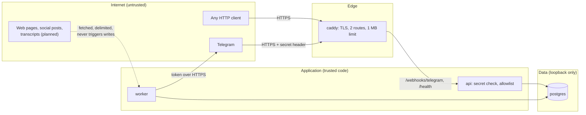

# Security

This document describes what the system protects, from whom, and how. It covers the code that exists today and states the constraints that planned modules must respect. Gaps found during review are listed at the end with their tracking id from the [design review](../reviews/2026-10-28-design-review.md).

## Assets

| Asset | Why it matters |
|---|---|
| Telegram bot token | Full control of the bot: read updates, send messages as Dzdia, change the webhook. |
| Webhook secret | Lets a caller inject fake updates into the queue. |
| Database (`jobs` today) | Holds journalists' messages and Telegram profile data from the raw update. |
| LLM API keys | Billing and quota. |
| WordPress application password (planned) | Can create drafts on dzdia.com. |
| Editorial integrity (planned) | A published hallucination or an injected instruction damages the media's credibility. |

## Trust boundaries

Three boundaries matter:

1. **Internet to edge.** Only Caddy listens publicly (ports 80 and 443). It forwards two paths and answers 404 to everything else. The API and Postgres ports are bound to `127.0.0.1`.
2. **Edge to application.** A request reaches the queue only with the right secret header, from an allowlisted user, in an allowed chat.
3. **Content to model (planned).** Text fetched from the web or transcribed from media is data, not instructions. It is delimited in prompts and the model that reads it has no write tool.

## Threats and mitigations

| Threat | Mitigation | Where |
|---|---|---|
| Forged webhook calls | `X-Telegram-Bot-Api-Secret-Token` compared in constant time (`hmac.compare_digest`); 401 on mismatch. Secret of 32 to 256 characters, validated at startup. | `api/webhook.py`, `config.py` |
| Unauthorized users consuming quota or reaching tools | Allowlist of Telegram user ids, **fail closed** (empty list refuses everyone). In groups, the sender must be listed **and** the group must be the team group. Refusals are logged with ids, without message text. | `api/webhook.py`, [ADR-0005](../adr/0005-telegram-ingress.md) |
| Replay of a legitimate update | Unique `dedup_key` per `update_id`; a replay creates no job. | `db/repository.py` |
| Bot token leak through the API | The API process never receives the token: settings are split per process and compose passes each service only its variables. | `config.py`, `docker-compose.yml`, [ADR-0006](../adr/0006-docker-image-and-compose.md) |
| Token leak through logs or errors | Token redacted from error messages; `httpx`/`httpcore` request logs (which contain the Bot API URL) raised to WARNING; `jobs.last_error` built from redacted messages. | `channels/telegram.py`, `logging_setup.py` |
| Personal data in logs or errors | Logs carry ids, never message text. Payload validation errors are reduced to an error count before reaching `last_error`. | `worker/handlers.py`, `logging_setup.py` |
| Secrets baked into images | `.dockerignore` is an allowlist: only `pyproject.toml`, `uv.lock`, `README.md` and `src/` enter the build context. | `.dockerignore` |
| Container escape impact | Runtime image without build tools, running as non-root user `app` (uid 10001). | `Dockerfile` |
| Oversized or abusive requests | Caddy refuses bodies above 1 MB; interactive API docs and OpenAPI schema are disabled. | `Caddyfile`, `api/app.py` |
| Markup injection from model output (v1 bug #7) | Messages are sent without `parse_mode`: text is never interpreted as Markdown or HTML. | `channels/telegram.py` |
| Prompt injection from external content (planned) | Delimit untrusted content; injection detection is only a logged signal; the real control is that no model reading untrusted content can call a write tool, and every write requires a persisted `APPROVED` state. | Planned: `guardrails/`, `domain/workflow.py` |
| SSRF through user-supplied links (planned) | Resolve DNS, refuse private, loopback and link-local addresses (including `169.254.169.254`), limit size, content type, redirects and time. | Planned: `guardrails/ssrf.py` |
| Over-privileged CMS account (planned) | Dedicated WordPress user with the Contributor role, which cannot publish; `status="draft"` forced in code as a second barrier. | Planned: `tools/wordpress.py` |

## Secrets handling

- Secrets live in `.env` on the host, outside Git (`.gitignore`) and outside images (`.dockerignore`).
- In code, secrets are `pydantic.SecretStr`: they are not printed in `repr` or validation errors, and are unwrapped only where used.
- Which service receives which variable is listed in [configuration](../operations/configuration.md).
- Rotation procedures for the webhook secret and the bot token are in the [runbook](../operations/runbook.md).

## Data protection

- **Collected:** message text and metadata from allowlisted journalists, plus the full Telegram update (`raw`), which includes profile fields such as first name and username.
- **Stored:** in the `jobs` table, in the `payload` column. There is currently no retention limit (gap R4/S3).
- **Sent to third parties (planned):** source material and prompts to the LLM provider. Whether a free tier allows training on submitted data must be checked per provider and region before production use, as required by the product spec.
- **Planned:** audio and video files deleted after transcription; an `audit_logs` table for tool calls (tool, arguments, user, result, cost).

## Supply chain

- Python packages are locked with hashes (`uv.lock`); images are pinned by tag and digest; GitHub Actions by commit SHA. Dependabot proposes updates weekly, and a guard test fails on any unpinned reference.
- The CI audits every locked package for known advisories (`pip-audit`, also weekly), builds the image for amd64 and arm64, and runs with a read-only token.
- Not covered yet: scanning the OS packages of the image (Trivy or similar), and signing or attesting images (none are published).

Details and procedures: [conventions](../development/conventions.md#dependencies-and-supply-chain).

## Known gaps

| Id | Gap | Planned fix |
|---|---|---|
| R4 / S3 | Job payloads (message text, raw update) are kept forever. | Retention job and payload minimization, with an ADR. |
| S4 | `POSTGRES_PASSWORD` is interpolated into a URL and must be URL-safe. | Documented in [configuration](../operations/configuration.md). |
| S5 | The webhook route accepts any source IP (the secret is the control). | Optional: restrict to Telegram's published IP ranges in Caddy. |
| R7 | After an outage, Telegram redelivers up to 24 h of updates and the bot answers stale messages. | Ignore or flag messages older than a threshold. |
