# Baseline v1: hallucination measurement

Before rewriting the bot, we measure how often the legacy v1 states facts that are not in its source. The same protocol will then measure v2 on the same sources, so the before/after comparison is like for like. This page summarizes the method, the pipeline and the current results; the decisions and their alternatives are in [ADR-0001](../adr/0001-baseline-hallucination-protocol.md), [ADR-0002](../adr/0002-algerie-360-replaces-el-watan.md) and [ADR-0003](../adr/0003-automated-reference-review.md).

Code: [`evals/baseline_v1/`](../../evals/baseline_v1/). Committed data: [`evals/datasets/baseline_v1/`](../../evals/datasets/baseline_v1/).

## Question

v1 sends the raw URL to the model and never downloads the page. How much of what it writes is supported by the article behind the link?

## Method

| Aspect | Choice |
|---|---|
| What is measured | **Faithfulness to the source**, not real-world truth: an element absent from the source counts as unsupported even if it is true. |
| Unit | **Critical element**: person, organization, place, number, date or quote stated in the output. |
| Metrics | Share of unsupported elements (by type and overall); share of outputs with at least one unsupported element; share of contradicted elements. |
| Sample | 16 recent articles from the RSS feeds of TSA Algérie and Algérie 360 (8 each), plus 4 duplicates of TSA articles reached through an opaque `?p=ID` URL, to isolate the effect of the slug. Paywalled articles are excluded. |
| Reference text | Article page frozen once (HTML, extracted text, SHA-256), headline included, "À LIRE AUSSI" cross-links removed, checked before use. |
| Conditions | `url_only` (v1 as shipped: the prompt receives the URL), `page_text` (same v1 prompts, given the real page text), `v2` later. |
| Repetitions | 3 summaries and 1 article per item and condition. |
| Model | v1 prompts copied verbatim (`v1-frozen`) with v1's model, `gemini-3.1-flash-lite-preview`, default parameters. |
| Extractor | `gemini-3.1-pro-preview`, thinking level `low`, temperature 0, structured output ([ADR-0008](../adr/0008-baseline-extractor-model.md)). |
| Labels | `SUPPORTED`, `CONTRADICTED`, `NOT_IN_SOURCE`, assigned by a human against the reference text. |
| Uncertainty | 95 % confidence intervals from a **cluster bootstrap over articles**: elements of one article are not independent, so articles are resampled, not elements. |
| Pending labels | Elements that are `not_found` and not yet labeled are **pending**. They are not missing at random (they are the likeliest to be unsupported), so the element and output rates are reported as **worst-case bounds** until labeling is complete: pending counted as supported, then as unsupported. The report flags itself as provisional and counts pending elements and undetermined outputs. |

## Pipeline

```mermaid
flowchart LR
    sample["sample<br/>RSS -> frozen URL list"] --> snapshot["snapshot<br/>HTML + text + hashes"]
    snapshot --> review["review-done<br/>reference checked"]
    review --> run["run<br/>v1 prompts x conditions"]
    run --> extract["extract<br/>LLM, structured output"]
    extract --> match["match<br/>deterministic, code"]
    match --> label["export / import-labels<br/>human, CSV"]
    label --> report["report<br/>rates + bootstrap CI"]
```



| Step | Who | What it does |
|---|---|---|
| `sample` | code | Takes the most recent entries of each feed and adds seeded opaque duplicates. Refuses to overwrite a frozen sample without `--force`. |
| `snapshot` | code | Downloads each page, extracts the main text with trafilatura, rejects paywalled pages, stores HTML and text locally and hashes in the repository. Checks that each opaque URL redirects to its original. |
| `review-done` | human or scripted check | Marks a reference text as reviewed and records its hash; `run` refuses unreviewed references unless `--allow-unreviewed` is given. |
| `run` | LLM (model under test) | Executes the frozen prompts. Each result is appended as soon as it completes; re-running retries only failed runs. |
| `extract` | LLM (extractor) | Lists the critical elements of each output, as structured output. The output text is passed inside delimiters as data. |
| `match` | code | Looks for each element in the reference text: numbers on a canonical form (`1 500 000` = `1500000`, `1,5` = `1.5`), dates and quotes as exact token sequences, names as exact sequences or fuzzy matches against same-length word windows (so "Alger" does not match inside "Algérie"). |
| `export-labels`, `import-labels` | human | Every `not_found` element, plus a stable 20 % hash-based sample of `found` elements to measure the matcher's precision, goes to an Excel-friendly CSV. |
| `report` | code | Computes the rates and intervals and writes `report.md`. |

Every step is idempotent and resumable: records carry deterministic ids and re-running a step skips what is already done.

## Labeling guide

Each row of `to_label.csv` is one element of a v1 output. `value` is the element and `context` is the sentence of the output that states it, both copied verbatim from the text **v1 wrote**, not from the article. `condition` says what v1 had: only the URL (`url_only`) or the page text (`page_text`). `match_status` is the automatic search: `found` means the code found `value` in the reference text (accents, case, name spellings and number formats tolerated), `not_found` means it did not.

The labeler opens the reference text of the row's article (`evals/.data/baseline_v1/snapshots/<item>.txt`; the `-opaque` duplicates use the text of the same TSA article) and asks: **does the article state what `context` says about `value`?**

| The article... | Label |
|---|---|
| states the same thing about this element | `S` (SUPPORTED) |
| states something incompatible: another number, place, date, or a quote given to someone else | `C` (CONTRADICTED) |
| says nothing about it | `N` (NOT_IN_SOURCE) |

- A `found` row only says the string is in the article: check that it is used in the same sense. "Constantine" is `C` if the article places the event in Constantine and the output places it in Oran.
- A `not_found` row may be worded differently in the article ("algérien" for "Algérie"): search for synonyms and other spellings before choosing `N`.
- A quote is a promise of the exact words. A quote reworded by the output, even with the same meaning and the right speaker, is `C` (rule set by Abdou on 2026-11-13 during the review).
- Before choosing `N`, search the live article page too ([ADR-0003](../adr/0003-automated-reference-review.md)): if the element is there but missing from the snapshot, label `S` and write `absent du snapshot` in `note`.
- Doubtful cases get the closest label and a reason in `note`. A fact of the output that the extractor missed goes in `note` on a row of the same run: it measures the extractor's recall.
- Rows can be left blank; they stay pending, and the report says so.

## Data handling

- Article text and raw model outputs are copyrighted or derived from copyrighted text: they stay in `evals/.data/` (gitignored and excluded from Docker builds).
- The repository keeps only the sample, snapshot metadata and hashes, and later the human labels and the report.
- Run and extraction records carry the model name, the prompt version, a timestamp and the latency.
- **Element ids are derived from the content**, not from the position in the extractor output: `<run_id>#<type>:<hash>`, where the hash covers the type and the value (Unicode NFC, case folded, whitespace collapsed; accents kept). A repeat of the same value in one run gets a suffix `~2`, `~3`. A re-extraction that finds the same element gives it the same id, so its human label still applies; a changed element gets a new id and goes back to pending, never inheriting another element's label. The labels file holds only ids and verdicts, never model output.

## Status

| Step | Status |
|---|---|
| `sample`, `snapshot`, review | Done: 16 articles and 4 opaque duplicates; references checked automatically (ADR-0003). |
| `run` | Done: 144/144 runs with `gemini-3.1-flash-lite-preview`. Median latency 7.7 s, maximum 87.9 s. |
| `extract` | Done on 2026-11-09: 144/144 with `gemini-3.1-pro-preview` (thinking `low`), no failure, 733 elements; 5 outputs state no element. Tokens: 69,681 input, 45,264 output, 96,597 thinking (about 1.85 $). The recorded latencies of this pass include the wait for a concurrency slot (fixed afterwards). |
| `match` | Done on 2026-11-09: 600 `found`, 133 `not_found` (`url_only`: 195 / 93; `page_text`: 405 / 40). |
| Labeling | Done on 2026-11-13 by Abdou: 252 elements (the 133 `not_found` and 119 `found` from the 20 % audit sample), 0 pending. Mechanical consistency checks (no LLM) flagged 20 rows; Abdou reviewed them himself and changed 13. |
| `report` | Done on 2026-11-13: final, no "Provisional report" banner ([`report.md`](../../evals/datasets/baseline_v1/report.md)). |

## Results

On the 16 original articles (opaque duplicates excluded), both tasks together, 95 % CI from the cluster bootstrap:

| Condition | Outputs | Elements | Unsupported elements | Outputs with ≥ 1 unsupported |
|---|---|---|---|---|
| `url_only` (v1 as shipped) | 64 | 258 | **28 % [21–35 %]** (72/258) | 41 % [30–53 %] (26/64) |
| `page_text` (same prompts, given the page text) | 64 | 445 | 5 % [3–8 %] (24/445) | 28 % [19–38 %] (18/64) |

- Not opening the link multiplies the share of unsupported elements by about 5. In `url_only`, generated **articles** reach 48 % [39–56 %] unsupported elements and 15 of 16 contain at least one; **quotes** are unsupported at 67 % [47–92 %].
- The slug matters: through an opaque `?p=ID` URL, 70 % [46–88 %] of elements are unsupported, against 22 % [10–39 %] for the same four articles reached through their normal URL.
- **These are lower bounds.** Unaudited `found` elements count as supported, and the audit found 86 % [68–100 %] of `url_only` `found` elements supported (30/35; 95 % for `page_text`). See the limitations below.

## Known limitations

- **Small sample.** 20 URLs give wide intervals; the report shows them rather than hiding them.
- **French only.** No Arabic-language source was available; Arabic will be evaluated separately.
- **Extractor recall.** Elements the extractor misses are invisible to the metrics. The human labeler checks the extracted list while labeling.
- **Extractor choice.** The model under test cannot extract its own elements (self-evaluation bias). A lighter model tested on 20 runs found 76 % of distinct elements but only 2 of 7 quotes and 8 of 16 organizations, so it would underestimate hallucinations; it was rejected. The extractor, `gemini-3.1-pro-preview`, is from the same family as the model under test; it judges nothing (code and a human do), but the shared family can still affect which elements are listed ([ADR-0008](../adr/0008-baseline-extractor-model.md)).
- **Matcher false positives make every rate a lower bound.** An element can be "found" in a different context than the one stated ("2027" is in the article, but the output says something else about it). Only the 20 % audit sample is labeled; the other `found` elements count as supported. The audit shows 86 % precision in `url_only` (5 of 35 unsupported) and 95 % in `page_text`, so the true `url_only` rate is above 28 %; extrapolating the audit would put it near 36 %, an estimate not used in the report. Labeling the 150 unaudited `url_only` `found` elements would remove the assumption.
- **Corpus scope.** The 16 articles are general Algerian news (politics, visas, economy, transport) from TSA and Algérie 360, not the positive cultural content Dzdia publishes. The mechanism measured (v1 never opens the link) does not depend on the topic, but the exact rate does: the model may know less about a local artist than about Schengen visas. The v2 evaluation set should come from the content the team will actually send.
- **One labeler.** All labels come from one person, with no second labeler, so inter-annotator agreement is not measured. Mechanical checks caught one rule applied two ways (reworded quotes); all reworded quotes are now `C`.
- **Provisional figures while labeling.** Until every pending element is labeled, the element and output rates are ranges, and the contradicted and per-type rates cover decided elements only ([B6](../reviews/2026-10-28-design-review.md#b6--output-level-rate-is-a-lower-bound-while-labels-are-pending)). Only a report without the "Provisional report" banner gives final numbers.
- **Adjacent numbers.** Since [B7](../reviews/2026-10-28-design-review.md#b7--adjacent-numbers-merged), a year followed by a number reads as two numbers; "le 12 450 participants" still reads 12450, which only adds an element to label.

## Reproducing

```bash
uv run python -m evals.baseline_v1 --help
uv run python -m evals.baseline_v1 run            # needs GEMINI_API_KEY
uv run python -m evals.baseline_v1 extract
uv run python -m evals.baseline_v1 match
uv run python -m evals.baseline_v1 export-labels  # fill the CSV with S / C / N
uv run python -m evals.baseline_v1 import-labels
uv run python -m evals.baseline_v1 report
```

The frozen sample and hashes are committed; the snapshot texts are not, so a third party can verify the sample and the hashes but must fetch the pages again to rerun the pipeline.
