# Baseline v1: hallucination measurement

Before rewriting the bot, we measure how often the legacy v1 states facts that are not in its source. The same protocol will then measure v2 on the same sources, so the before/after comparison is like for like. This page summarizes the method, the pipeline and the current results; the decisions and their alternatives are in [ADR-0001](../adr/0001-baseline-hallucination-protocol.md), [ADR-0002](../adr/0002-algerie-360-replaces-el-watan.md) and [ADR-0003](../adr/0003-automated-reference-review.md).

Code: [`evals/baseline_v1/`](../../evals/baseline_v1/). Committed data: [`evals/datasets/baseline_v1/`](../../evals/datasets/baseline_v1/).

## Question

v1 sends the raw URL to the model and never downloads the page. How much of what it writes is supported by the article behind the link?

## Method

| Aspect | Choice |
|---|---|
| What is measured | **Faithfulness to the source**, not real-world truth: an element absent from the source counts as unsupported even if it is true. |
| Unit | **Critical element**: person, organization, place, number, date or quote stated in the output. |
| Metrics | Share of unsupported elements (by type and overall); share of outputs with at least one unsupported element; share of contradicted elements. |
| Sample | 16 recent articles from the RSS feeds of TSA Algérie and Algérie 360 (8 each), plus 4 duplicates of TSA articles reached through an opaque `?p=ID` URL, to isolate the effect of the slug. Paywalled articles are excluded. |
| Reference text | Article page frozen once (HTML, extracted text, SHA-256), headline included, "À LIRE AUSSI" cross-links removed, checked before use. |
| Conditions | `url_only` (v1 as shipped: the prompt receives the URL), `page_text` (same v1 prompts, given the real page text), `v2` later. |
| Repetitions | 3 summaries and 1 article per item and condition. |
| Model | v1 prompts copied verbatim (`v1-frozen`) with v1's model, `gemini-3.1-flash-lite-preview`, default parameters. |
| Labels | `SUPPORTED`, `CONTRADICTED`, `NOT_IN_SOURCE`, assigned by a human against the reference text. |
| Uncertainty | 95 % confidence intervals from a **cluster bootstrap over articles**: elements of one article are not independent, so articles are resampled, not elements. |

## Pipeline

```mermaid
flowchart LR
    sample["sample<br/>RSS -> frozen URL list"] --> snapshot["snapshot<br/>HTML + text + hashes"]
    snapshot --> review["review-done<br/>reference checked"]
    review --> run["run<br/>v1 prompts x conditions"]
    run --> extract["extract<br/>LLM, structured output"]
    extract --> match["match<br/>deterministic, code"]
    match --> label["export / import-labels<br/>human, CSV"]
    label --> report["report<br/>rates + bootstrap CI"]
```



| Step | Who | What it does |
|---|---|---|
| `sample` | code | Takes the most recent entries of each feed and adds seeded opaque duplicates. Refuses to overwrite a frozen sample without `--force`. |
| `snapshot` | code | Downloads each page, extracts the main text with trafilatura, rejects paywalled pages, stores HTML and text locally and hashes in the repository. Checks that each opaque URL redirects to its original. |
| `review-done` | human or scripted check | Marks a reference text as reviewed and records its hash; `run` refuses unreviewed references unless `--allow-unreviewed` is given. |
| `run` | LLM (model under test) | Executes the frozen prompts. Each result is appended as soon as it completes; re-running retries only failed runs. |
| `extract` | LLM (extractor) | Lists the critical elements of each output, as structured output. The output text is passed inside delimiters as data. |
| `match` | code | Looks for each element in the reference text: numbers on a canonical form (`1 500 000` = `1500000`, `1,5` = `1.5`), dates and quotes as exact token sequences, names as exact sequences or fuzzy matches against same-length word windows (so "Alger" does not match inside "Algérie"). |
| `export-labels`, `import-labels` | human | Every `not_found` element, plus a stable 20 % hash-based sample of `found` elements to measure the matcher's precision, goes to an Excel-friendly CSV. |
| `report` | code | Computes the rates and intervals and writes `report.md`. |

Every step is idempotent and resumable: records carry deterministic ids and re-running a step skips what is already done.

## Data handling

- Article text and raw model outputs are copyrighted or derived from copyrighted text: they stay in `evals/.data/` (gitignored and excluded from Docker builds).
- The repository keeps only the sample, snapshot metadata and hashes, and later the human labels and the report.
- Run and extraction records carry the model name, the prompt version, a timestamp and the latency.
- **Element ids are derived from the content**, not from the position in the extractor output: `<run_id>#<type>:<hash>`, where the hash covers the type and the value (Unicode NFC, case folded, whitespace collapsed; accents kept). A repeat of the same value in one run gets a suffix `~2`, `~3`. A re-extraction that finds the same element gives it the same id, so its human label still applies; a changed element gets a new id and goes back to pending, never inheriting another element's label. The labels file holds only ids and verdicts, never model output.

## Status

| Step | Status |
|---|---|
| `sample`, `snapshot`, review | Done: 16 articles and 4 opaque duplicates; references checked automatically (ADR-0003). |
| `run` | Done: 144/144 runs with `gemini-3.1-flash-lite-preview`. Median latency 7.7 s, maximum 87.9 s. |
| `extract` | To be run again from zero (0/144): the 20 extractions made before the B5 fix have no timestamp and were set aside locally. The free tier of the extraction model allows 20 requests per day, and the extractor model must be chosen first (see below). |
| `match`, labeling, `report` | Not started. |

## Known limitations

- **Small sample.** 20 URLs give wide intervals; the report shows them rather than hiding them.
- **French only.** No Arabic-language source was available; Arabic will be evaluated separately.
- **Extractor recall.** Elements the extractor misses are invisible to the metrics. The human labeler checks the extracted list while labeling.
- **Extractor choice.** The model under test cannot extract its own elements (self-evaluation bias). A lighter model tested on 20 runs found 76 % of distinct elements but only 2 of 7 quotes and 8 of 16 organizations, so it would underestimate hallucinations; it was rejected. All 144 extractions will be redone with a single model once it is chosen.
- **Matcher false positives.** An element can be "found" in a different context than the one stated. The 20 % audit sample measures this.
- **Open issues in the harness** (from the [design review](../reviews/2026-10-28-design-review.md)): the output-level rate is a lower bound while elements are pending (B6); two adjacent numbers can be read as one (B7).

## Reproducing

```bash
uv run python -m evals.baseline_v1 --help
uv run python -m evals.baseline_v1 run            # needs GEMINI_API_KEY
uv run python -m evals.baseline_v1 extract
uv run python -m evals.baseline_v1 match
uv run python -m evals.baseline_v1 export-labels  # fill the CSV with S / C / N
uv run python -m evals.baseline_v1 import-labels
uv run python -m evals.baseline_v1 report
```

The frozen sample and hashes are committed; the snapshot texts are not, so a third party can verify the sample and the hashes but must fetch the pages again to rerun the pipeline.
