# Baseline v1: hallucination measurement

Before rewriting the bot, we measure how often the legacy v1 states facts that are not in its source. The same protocol then measures v2 on the same sources, in the [v2 comparison](v2-comparison.md). This page summarizes the method, the pipeline and the results; the decisions and their alternatives are in [ADR-0001](../adr/0001-baseline-hallucination-protocol.md), [ADR-0002](../adr/0002-algerie-360-replaces-el-watan.md), [ADR-0003](../adr/0003-automated-reference-review.md) and, for how the figures are reported, [ADR-0016](../adr/0016-baseline-reported-per-task.md).

Code: [`evals/baseline_v1/`](../../evals/baseline_v1/). Committed data: [`evals/datasets/baseline_v1/`](../../evals/datasets/baseline_v1/).

## Question

v1 sends the raw URL to the model and never downloads the page. How much of what it writes is supported by the article behind the link?

## Method

| Aspect | Choice |
|---|---|
| What is measured | **Faithfulness to the source**, not real-world truth: an element absent from the source counts as unsupported even if it is true. |
| Unit | **Critical element**: person, organization, place, number, date or quote stated in the output. |
| Metrics | Share of unsupported elements (by type and overall); share of outputs with at least one unsupported element; share of contradicted elements. |
| Sample | 16 recent articles from the RSS feeds of TSA Algérie and Algérie 360 (8 each), plus 4 duplicates of TSA articles reached through an opaque `?p=ID` URL, to isolate the effect of the slug. Paywalled articles are excluded. |
| Reference text | Article page frozen once (HTML, extracted text, SHA-256), headline included, "À LIRE AUSSI" cross-links removed, checked before use. |
| Conditions | `url_only` (v1 as shipped: the prompt receives the URL), `page_text` (same v1 prompts, given the real page text). The v2 arms run in a separate command, the [v2 comparison](v2-comparison.md), which reuses the `page_text` article runs. |
| Repetitions | 3 summaries and 1 article per item and condition. |
| Model | v1 prompts copied verbatim (`v1-frozen`) with v1's model, `gemini-3.1-flash-lite-preview`, default parameters. |
| Extractor | `gemini-3.1-pro-preview`, thinking level `low`, temperature 0, structured output ([ADR-0008](../adr/0008-baseline-extractor-model.md)). |
| Labels | `SUPPORTED`, `CONTRADICTED`, `NOT_IN_SOURCE`, assigned by a human against the reference text. |
| Label coverage | Every `not_found` element and a 20 % sample of the `found` ones are labeled; the other `found` elements count as supported. One cell, `url_only / article`, is labeled in full ([ADR-0016](../adr/0016-baseline-reported-per-task.md)). |
| Uncertainty | 95 % confidence intervals from a **cluster bootstrap over articles**: elements of one article are not independent, so articles are resampled, not elements. |
| Rate or floor | A figure is printed as a rate with its interval only when every `found` element of its population is labeled. Otherwise it is a **floor**, written `≥ X% (k/n), CI from L%`: the unlabeled `found` elements count as supported, so the true rate can only be higher, and no upper end is given. |
| Reporting unit | Per condition and task. The article task is the product's task and is quoted first; the rows that pool both tasks are a blend that moves with the number of summaries generated per article, and are not quoted as a result. |
| Pending labels | Elements that are `not_found` and not yet labeled are **pending**. They are not missing at random (they are the likeliest to be unsupported), so the element and output rates are reported as **worst-case bounds** until labeling is complete: pending counted as supported, then as unsupported. The report flags itself as provisional and counts pending elements and undetermined outputs. |

## Pipeline

```mermaid
flowchart LR
    sample["sample<br/>RSS -> frozen URL list"] --> snapshot["snapshot<br/>HTML + text + hashes"]
    snapshot --> review["review-done<br/>reference checked"]
    review --> run["run<br/>v1 prompts x conditions"]
    run --> extract["extract<br/>LLM, structured output"]
    extract --> match["match<br/>deterministic, code"]
    match --> label["export / import-labels<br/>human, CSV"]
    label --> report["report<br/>rates + bootstrap CI"]
```



| Step | Who | What it does |
|---|---|---|
| `sample` | code | Takes the most recent entries of each feed and adds seeded opaque duplicates. Refuses to overwrite a frozen sample without `--force`. |
| `snapshot` | code | Downloads each page, extracts the main text with trafilatura, rejects paywalled pages, stores HTML and text locally and hashes in the repository. Checks that each opaque URL redirects to its original. |
| `review-done` | human or scripted check | Marks a reference text as reviewed and records its hash; `run` refuses unreviewed references unless `--allow-unreviewed` is given. |
| `run` | LLM (model under test) | Executes the frozen prompts. Each result is appended as soon as it completes; re-running retries only failed runs. |
| `extract` | LLM (extractor) | Lists the critical elements of each output, as structured output. The output text is passed inside delimiters as data. |
| `match` | code | Looks for each element in the reference text: numbers on a canonical form (`1 500 000` = `1500000`, `1,5` = `1.5`), dates and quotes as exact token sequences, names as exact sequences or fuzzy matches against same-length word windows (so "Alger" does not match inside "Algérie"). |
| `export-labels`, `import-labels` | human | Every `not_found` element, plus a stable 20 % hash-based sample of `found` elements to measure the matcher's precision, goes to an Excel-friendly CSV. With `--cell CONDITION TASK`, the sheet holds instead every `found` element of that condition and task that has no label yet, on the original articles, in a file of its own (`to_label_<condition>_<task>.csv`); `import-labels --cell` reads it into the same labels file ([ADR-0016](../adr/0016-baseline-reported-per-task.md), point 2). `export-labels` refuses to overwrite an existing sheet without `--force`: a sheet can hold labels and notes that were not imported. |
| `report` | code | Computes the rates and intervals and writes `report.md`. |

Every step is idempotent and resumable: records carry deterministic ids and re-running a step skips what is already done.

## Labeling guide

Each row of `to_label.csv` is one element of a v1 output. `value` is the element and `context` is the sentence of the output that states it, both copied verbatim from the text **v1 wrote**, not from the article. `condition` says what v1 had: only the URL (`url_only`) or the page text (`page_text`). `match_status` is the automatic search: `found` means the code found `value` in the reference text (accents, case, name spellings and number formats tolerated), `not_found` means it did not.

The labeler opens the reference text of the row's article (`evals/.data/baseline_v1/snapshots/<item>.txt`; the `-opaque` duplicates use the text of the same TSA article) and asks: **does the article state what `context` says about `value`?**

| The article... | Label |
|---|---|
| states the same thing about this element | `S` (SUPPORTED) |
| states something incompatible: another number, place, date, or a quote given to someone else | `C` (CONTRADICTED) |
| says nothing about it | `N` (NOT_IN_SOURCE) |

- A `found` row only says the string is in the article: check that it is used in the same sense. "Constantine" is `C` if the article places the event in Constantine and the output places it in Oran.
- A `not_found` row may be worded differently in the article ("algérien" for "Algérie"): search for synonyms and other spellings before choosing `N`.
- A quote is a promise of the exact words. A quote reworded by the output, even with the same meaning and the right speaker, is `C` (rule set by Abdou on 2026-11-13 during the review).
- Before choosing `N`, search the live article page too ([ADR-0003](../adr/0003-automated-reference-review.md)): if the element is there but missing from the snapshot, label `S` and write `absent du snapshot` in `note`.
- Doubtful cases get the closest label and a reason in `note`. A fact of the output that the extractor missed goes in `note` on a row of the same run: it measures the extractor's recall.
- Rows can be left blank; they stay pending, and the report says so.
- A sheet exported with `--cell` follows the same guide. It is not blind: every row is a `found` element of one condition and task, so the first rule above is the one that applies, and a row left blank keeps counting as supported, which the report shows as an unlabeled `found` element.

## Data handling

- Article text and raw model outputs are copyrighted or derived from copyrighted text: they stay in `evals/.data/` (gitignored and excluded from Docker builds).
- The repository keeps only the sample, snapshot metadata and hashes, and later the human labels and the report.
- Run and extraction records carry the model name, the prompt version, a timestamp and the latency.
- **Element ids are derived from the content**, not from the position in the extractor output: `<run_id>#<type>:<hash>`, where the hash covers the type and the value (Unicode NFC, case folded, whitespace collapsed; accents kept). A repeat of the same value in one run gets a suffix `~2`, `~3`. A re-extraction that finds the same element gives it the same id, so its human label still applies; a changed element gets a new id and goes back to pending, never inheriting another element's label. The labels file holds only ids and verdicts, never model output: the import does not copy the labeler's notes, which can quote the article or the output, and keeps only the marker `locuteur` when a note contains it. The full notes stay in the local sheet.

## Status

| Step | Status |
|---|---|
| `sample`, `snapshot`, review | Done: 16 articles and 4 opaque duplicates; references checked automatically (ADR-0003). |
| `run` | Done: 144/144 runs with `gemini-3.1-flash-lite-preview`. Median latency 7.7 s, maximum 87.9 s. |
| `extract` | Done on 2026-11-09: 144/144 with `gemini-3.1-pro-preview` (thinking `low`), no failure, 733 elements; 5 outputs state no element. Tokens: 69,681 input, 45,264 output, 96,597 thinking (about 1.85 $). The recorded latencies of this pass include the wait for a concurrency slot (fixed afterwards). |
| `match` | Done on 2026-11-09: 600 `found`, 133 `not_found` (`url_only`: 195 / 93; `page_text`: 405 / 40). |
| Labeling | Done on 2026-11-13 by Abdou: 252 elements (the 133 `not_found` and 119 `found` from the 20 % audit sample), 0 pending. Mechanical consistency checks (no LLM) flagged 20 rows; Abdou reviewed them himself and changed 13. |
| Second reading | On 2026-11-14 Abdou read all 252 rows again, alone and with no LLM, and changed 29 labels: 13 from unsupported to supported, 7 from supported to unsupported, 9 between `C` and `N`. The same mechanical checks then flagged 11 rows; he read them again and kept them. The first sheet is kept locally. |
| Full labels on `url_only / article` | On 2026-11-14 the same labeler labeled the 49 `found` elements of this cell that the 20 % sample had left out, with the guide above, on a sheet of its own: 36 `S`, 10 `N`, 3 `C`. The sheet was not blind: every row was known to be a `found` element of that cell. The labels file now holds 301 labels. |
| `report` | Rebuilt on 2026-11-14 with these labels and the layout of [ADR-0016](../adr/0016-baseline-reported-per-task.md): final, no "Provisional report" banner ([`report.md`](../../evals/datasets/baseline_v1/report.md)). The earlier reports of 2026-11-13 and 2026-11-14 are in the Git history. |

## Results

On the 16 original articles (opaque duplicates excluded), reported per task ([ADR-0016](../adr/0016-baseline-reported-per-task.md)). The intervals are 95 % intervals from the cluster bootstrap over articles.

### Articles

**Given only the URL, v1 writes articles in which 57 % [48–67 %] of the checkable elements are unsupported by the source (72/126). Given the page text, the same prompt leaves 12.9 % [8.5–18.1 %] unsupported (33/256).**

| Condition | Articles | Elements (per article) | Unsupported elements | Articles with ≥ 1 unsupported | Labels |
|---|---|---|---|---|---|
| `url_only` (v1 as shipped) | 16 | 126 (7.9) | **57 % [48–67 %]** (72/126) | 15 of 16 | Every element, on the baseline's sheets, not blind |
| `page_text` (same prompt, given the page text) | 16 | 256 (16.0) | 12.9 % [8.5–18.1 %] (33/256) | 15 of 16 | Every element; 182 of them on the blind sheet of the [v2 comparison](v2-comparison.md#labels-and-report-2026-11-14) |

- **Both figures are rates**: every element of both cells has a label. The `page_text` rate is quoted from the v2 comparison. The baseline's own report does not read that labels file, so its row for this cell prints the floor, `≥ 6% (15/256)`.
- **No ratio between the two is given.** An article written from the URL alone states 7.9 checkable elements on average, one written from the page text 16.0: a vaguer text is less exposed, so the two rates do not rest on the same number of claims. In counts, the 16 `url_only` articles hold 72 unsupported elements, the 16 `page_text` articles 33.
- **`page_text` is the v1 prompt given the text, not a new system.** This pair says what opening the link changes for the old prompt. What v2 changes is measured in the [v2 comparison](v2-comparison.md).
- **By type, in the `url_only` articles:** places 71 % [55–84 %] (48/68) and quotes 72 % [52–100 %] (13/18). Persons (5/20), organizations (5/16) and dates (1/4) are too few for a useful interval, and the articles state no number.
- **What the full labels changed.** The floor for this cell was 47 % (59/126). Of the 49 `found` elements labeled afterwards, 13 are unsupported, 10 of them places. With the 20 % sample (1 of 13), 14 of the 62 `found` elements of the cell are unsupported: the string is in the source, but the article uses it for a claim the source does not make.

### Summaries

Both figures are floors: at least 11 % (15/132) in `url_only`, against at least 1 % (1/189) in `page_text`.

- In `url_only`, 101 `found` elements have no label, and 8 of the 22 labeled ones are unsupported: the rate is well above the floor.
- In `page_text`, 140 `found` elements have no label, and none of the 42 labeled ones is unsupported.
- Labeling the 101 `url_only` elements would turn the first floor into a rate; the same export option does it.

### Slug

Four TSA articles were also sent through an opaque `?p=ID` URL, which carries no word of the title. `url_only` outputs of all tasks, unsupported elements over elements:

| Article | Normal URL | Opaque URL |
|---|---|---|
| `tsa-00` | 2/7 | 3/6 |
| `tsa-01` | 2/15 | 2/2 |
| `tsa-02` | 3/16 | 3/7 |
| `tsa-05` | 8/16 | 13/15 |
| All four | 15/54 | 21/30 |

- **The share of unsupported elements rises in 4 articles of 4.** Four articles are too few to quantify the effect, so no interval is given; one article carries 13 of the 21 unsupported elements of the opaque side.
- **These counts are floors, unevenly.** 23 elements of the normal side and 9 of the opaque side have no label and count as supported. The full labels cover the articles of the normal side only, which works against the difference.

### First presentation, replaced

Until 2026-11-14 this page led with one figure for both tasks together: in `url_only`, at least 28 % [21–35 %] of elements unsupported (72/258) on the first reading of the labels, then 29 % [21–36 %] (74/258) on the second, against 5 % then 4 % for `page_text`. It was replaced for three reasons, raised by the [independent review](../reviews/2026-11-13-independent-review.md) (findings E-1 to E-4):

- **It was a floor printed with a two-sided interval.** A reader takes the upper end as the limit of the truth; it was the upper end of the floor.
- **It was a blend.** It pooled 48 summaries and 16 articles, at 11 % and 47 %, because three summaries are generated per article. The report still prints the pooled rows, named `all tasks (blend)`; with the full labels the `url_only` one reads `≥ 34% (87/258)`.
- **Two comparisons were not sound.** "Multiplies by about 8" divided two rates with different denominators. The slug result was printed with intervals from a bootstrap over four articles.

## Known limitations

- **Small sample.** 16 articles from two outlets, collected on one day, and 4 opaque duplicates: the intervals are wide, and the report shows them rather than hiding them.
- **Named elements only.** The metric sees persons, organizations, places, numbers, dates and quotes. An unsupported claim that names none of them is invisible, and a vague text states fewer elements to check.
- **French only.** No Arabic-language source was available; Arabic will be evaluated separately.
- **Extractor recall.** Elements the extractor misses are invisible to the metrics. The human labeler checks the extracted list while labeling.
- **Extractor choice.** The model under test cannot extract its own elements (self-evaluation bias). A lighter model tested on 20 runs found 76 % of distinct elements but only 2 of 7 quotes and 8 of 16 organizations, so it would underestimate hallucinations; it was rejected. The extractor, `gemini-3.1-pro-preview`, is from the same family as the model under test; it judges nothing (code and a human do), but the shared family can still affect which elements are listed ([ADR-0008](../adr/0008-baseline-extractor-model.md)).
- **Matcher false positives: three cells of four are floors.** An element can be "found" in a different context than the one stated ("2027" is in the article, but the output says something else about it). Outside the two article cells, only the 20 % sample of `found` elements is labeled and the others count as supported. A floor can be far from the rate: `page_text / article` went from 6 % (15/256) to 12.9 % (33/256) once the [v2 comparison](v2-comparison.md#labels-and-report-2026-11-14) had every element labeled, and `url_only / article` from 47 % (59/126) to 57 % (72/126).
- **The 20 % sample was not a good guide for the rest.** In `url_only / article` it held 1 unsupported element of 13; the 49 elements outside it hold 13. A draw of 13 elements with at most one unsupported comes about one time in seven when 14 of the 62 are unsupported, so chance can explain the gap: the sample was too small to extrapolate from, and no audit-weighted estimate is published.
- **The two rates of the article pair come from two labeling passes.** `url_only / article` was labeled on the baseline's sheets, which show the condition; the 49 added rows were known to be `found` elements of that cell, and they were labeled after the results were seen. 182 of the 256 `page_text / article` elements were labeled blind, with the comparison's guide. The comparison page notes that the earlier, non-blind labels may be more lenient.
- **No difference with an interval is given for the article pair.** The two rates are stated side by side. A paired difference would need the baseline's report to read the comparison's labels file.
- **Corpus scope.** The 16 articles are general Algerian news (politics, visas, economy, transport) from TSA and Algérie 360, not the positive cultural content Dzdia publishes. The mechanism measured (v1 never opens the link) does not depend on the topic, but the exact rate does: the model may know less about a local artist than about Schengen visas. The v2 evaluation set should come from the content the team will actually send.
- **One labeler.** All labels come from one person, with no second labeler, so inter-annotator agreement is not measured. Mechanical checks caught one rule applied two ways (reworded quotes); all reworded quotes are now `C`. A second reading of all 252 rows by the same labeler one day later changed 29 labels: the two readings agree on 223 of 252 labels (88 %), and on 232 of 252 (92 %) for supported against unsupported. One reading is not stable element by element, although the `url_only` rate moved by one point. The second reading was not blind to the first.
- **Provisional figures while labeling.** Until every pending element is labeled, the element and output rates are ranges, and the contradicted and per-type rates cover decided elements only ([B6](../reviews/2026-10-28-design-review.md#b6--output-level-rate-is-a-lower-bound-while-labels-are-pending)). Only a report without the "Provisional report" banner gives final numbers.
- **Adjacent numbers.** Since [B7](../reviews/2026-10-28-design-review.md#b7--adjacent-numbers-merged), a year followed by a number reads as two numbers; "le 12 450 participants" still reads 12450, which only adds an element to label.

## Reproducing

```bash
uv run python -m evals.baseline_v1 --help
uv run python -m evals.baseline_v1 run            # needs GEMINI_API_KEY
uv run python -m evals.baseline_v1 extract
uv run python -m evals.baseline_v1 match
uv run python -m evals.baseline_v1 export-labels  # fill the CSV with S / C / N
uv run python -m evals.baseline_v1 import-labels
uv run python -m evals.baseline_v1 export-labels --cell url_only article  # the cell labeled in full
uv run python -m evals.baseline_v1 import-labels --cell url_only article
uv run python -m evals.baseline_v1 report
```

The frozen sample and hashes are committed; the snapshot texts are not, so a third party can verify the sample and the hashes but must fetch the pages again to rerun the pipeline.
