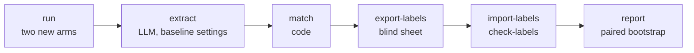

# v2 comparison

The v2 slice is measured against the v1 baseline on the article task, on the same 16 articles and the same frozen source texts. This page describes the harness; the protocol and its reasons are in [ADR-0010](../adr/0010-v2-comparison-protocol.md), and the choices of the harness in [ADR-0013](../adr/0013-v2-comparison-harness.md).

Code: [`evals/v2/compare/`](../../evals/v2/compare/). Committed data: `evals/datasets/v2_compare/` (labels, export log, check log, report). Local data: `evals/.data/v2_compare/` (model outputs, extractions, elements, the sheet, the key map).

## Arms

| Arm | Prompt | Pipeline | Source of the outputs |
| --- | --- | --- | --- |
| `page_text` | `v1-frozen` | v1 prompt, model defaults | The baseline's runs, reused as they are |
| `plain_prompt` | `v1-plain-1` | Free text out, the editorial instructions and temperature of v2, no evidence ids, no validator | Generated by this harness |
| `v2` | `v2-article-1` | Evidence ids, structured output, validation, one retry, removal of failed quotes | Generated by this harness |

All arms use the same model and receive the same text: the frozen snapshot of the article, capped at 30,000 characters. One generation per article and arm.

The comparison answers two questions. `v2 − page_text` is the primary result: does the v2 slice state fewer unsupported elements than v1 given the same text? `plain_prompt` splits that difference in two: what a plain prompt with the same instructions wins (`plain_prompt − page_text`), and what the architecture adds beyond it (`v2 − plain_prompt`).

## Steps



| Step | Status | What it does |
| --- | --- | --- |
| `run` | Done on 2026-11-13 | Runs `v2` then `plain_prompt` on each of the 16 articles. |
| `extract`, `match` | Written, not run | The baseline's extractor and matcher, on the plain output or the rendered v2 text. |
| `export-labels`, `import-labels`, `check-labels` | Written, not run | The blind sheet, its import into a labels file of its own, and three mechanical checks. |
| `report` | Planned | Rates per arm, paired differences with their intervals, guards, and the conclusion chosen by code. |

The harness reads the baseline's files and never writes them. The baseline command accepts only its own two conditions, `url_only` and `page_text`.

## The `run` step

```bash
uv run python -m evals.v2.compare run            # needs GEMINI_API_KEY
uv run python -m evals.v2.compare run --items tsa-00 --conditions v2
```

Before the first call, the step refuses to start when:

- a prompt differs from its pinned fingerprint (the prompts were frozen after the [tryout](v2-tryout.md));
- a snapshot text is missing or does not match its recorded hash;
- the model differs from the one of the baseline's `page_text` article runs.

A run is identified by article and arm (`<item_id>:<condition>:article:0`). The rules that keep "one generation per article":

- a generation that succeeded is never run again, and the step has no option to force it;
- a technical error (API, timeout) is recorded; running the step again retries it, and the error record stays in the file;
- a v2 generation that fails validation is a result: it is recorded, counted, and never retried.

Each record stores the model, the date, the prompt version and fingerprint, the settings sent, the hash of the input text, tokens and latency; for v2 also the outcome, each attempt with its issues, the quotes kept and removed, and the rendered text.

The step prints counters only, never model text: the person who labels must not read the outputs first. Its summary gives, per arm, the runs that succeeded, failed validation, hit a technical error or are missing. With more than two failed v2 generations it says that no headline comparison is published until the cause is understood (ADR-0010, point 12).

## The `extract` and `match` steps

```bash
uv run python -m evals.v2.compare extract        # needs GEMINI_API_KEY
uv run python -m evals.v2.compare match
```

`extract` gives the baseline's extractor, unchanged, the plain output or the rendered text of a v2 article.

- A v2 generation that failed validation has no article and is not extracted. A run in technical error is not extracted either.
- Before the first call, the step refuses to start when the extractor's model or thinking level differs from those of the baseline's `page_text` article extractions: the three arms must be read by the same extractor.
- A run that was extracted is skipped; an extraction in error is retried by running the step again.
- The elements go to `evals/.data/v2_compare/elements.jsonl`. The baseline's elements file is read, never written.

`match` runs the baseline's matcher, with its default threshold, against the snapshot text of each article.

Both steps print counters only. `match` prints the number of elements and no found / not found split, so nobody sees a provisional result.

## Labeling

Every element of the three arms is labeled by hand, blind to the arm. The rules are in the [labeling guide](v2-labeling-guide.md), frozen before the first export.

```bash
uv run python -m evals.v2.compare export-labels
uv run python -m evals.v2.compare import-labels
uv run python -m evals.v2.compare check-labels
```

### The blind sheet

`export-labels` writes `evals/.data/v2_compare/sheet.csv` (`;` separator, UTF-8 with BOM).

- **Rows:** every element of the two new arms, plus the `page_text` article elements that have no label in the baseline. The elements already labeled there are not shown again.
- **Columns:** `key;item_id;type;value;context;label;note`. The arm, the run id, the element id and the matcher's verdict are nowhere in the file.
- **Key:** the letter `k` and the first 10 hexadecimal characters of the SHA-256 of a committed seed and the element id. The letter keeps a spreadsheet from reading a key made of digits as a number and rewriting it. The export fails if two elements get the same key.
- **Order:** articles in sample order; inside an article, rows sorted by key. The key is a seeded hash, so this is a fixed shuffle across the arms.

The step refuses to start while a planned run has no result, an output is not extracted or an element is not matched. It also refuses to overwrite a sheet that holds labels not imported yet.

Each export writes only the rows that have no label yet. It also writes the key map (`keys.jsonl`, local) and appends a line to `evals/datasets/v2_compare/exports.jsonl`: date, seed, rows per article, and the SHA-256 of the labeling guide. Do not export again between two sittings: the sheet keeps every row, and a row flagged by `check-labels` must still be in it to be corrected.

### Import and checks

`import-labels` reads the filled rows; blank rows stay pending, so the sheet can be imported after each sitting.

- The whole sheet is checked first. An unknown key, an invalid label or a key filled on two rows stops the import before anything is written, and the message names the keys.
- `evals/datasets/v2_compare/labels.jsonl` is append-only: a label that changed is appended, and readers take the latest one per element. The file therefore shows how many labels were changed after a check. A blanked cell never removes a label.
- The baseline's `labels.jsonl` is not touched.

`check-labels` runs three checks fixed in advance (ADR-0013, point 7) on the labels of the sheet's rows, and lists the flagged rows by article and key:

1. a quote labeled `S` that the matcher did not find in the snapshot;
2. rows of one article with the same type and normalized value but different labels;
3. `locuteur` in the note of a row that is not a quote labeled `C`.

It appends its counts to `evals/datasets/v2_compare/checks.jsonl`. A flagged row is read again; the label is kept or changed in the sheet, then imported again.

No step prints an element value, an element id, an arm or a label.

## Results

No rate yet: the elements are not extracted or labeled.

### The run (2026-11-13)

One pass of the `run` step with `gemini-3.1-flash-lite-preview`: 32 generations, no technical error, nothing run twice.

| Arm | Generations | Failed validation | Technical errors | Used the retry | Quotes kept | Quotes removed | Median length |
| --- | --- | --- | --- | --- | --- | --- | --- |
| `v2` | 16 | 0 | 0 | 2 | 16 | 1 | 1,305.5 characters |
| `plain_prompt` | 16 | n/a | 0 | n/a | n/a | n/a | 1,455.5 characters |

- Both retries were triggered by one quote that was not in its cited evidence (`quote_not_in_evidence`). One retry fixed it; after the other the quote still failed and was removed.
- 9 of the 16 v2 articles keep at least one quote.
- No v2 generation failed, so the first guard of ADR-0010, point 12, does not apply.
- The median v2 article is 0.90 times as long as the median plain one. Both are well under the 3,517 characters of the `page_text` articles; whether an arm states fewer than two thirds of the elements of `page_text` is known after extraction.

Only aggregate counters are written here. Per-article counters are not, because the person who labels must not be able to tell the arms apart.
