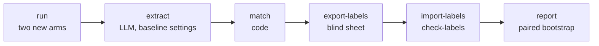

# v2 comparison

The v2 slice is measured against the v1 baseline on the article task, on the same 16 articles and the same frozen source texts. This page describes the harness; the protocol and its reasons are in [ADR-0010](../adr/0010-v2-comparison-protocol.md), and the choices of the harness in [ADR-0013](../adr/0013-v2-comparison-harness.md).

Code: [`evals/v2/compare/`](../../evals/v2/compare/). Committed data: `evals/datasets/v2_compare/` (labels, export log, check log, report). Local data: `evals/.data/v2_compare/` (model outputs, extractions, elements, the sheet, the key map).

## Arms

| Arm | Prompt | Pipeline | Source of the outputs |
| --- | --- | --- | --- |
| `page_text` | `v1-frozen` | v1 prompt, model defaults | The baseline's runs, reused as they are |
| `plain_prompt` | `v1-plain-1` | Free text out, the editorial instructions and temperature of v2, no evidence ids, no validator | Generated by this harness |
| `v2` | `v2-article-1` | Evidence ids, structured output, validation, one retry, removal of failed quotes | Generated by this harness |

All arms use the same model and receive the same text: the frozen snapshot of the article, capped at 30,000 characters. One generation per article and arm.

The comparison answers two questions. `v2 − page_text` is the primary result: does the v2 slice state fewer unsupported elements than v1 given the same text? `plain_prompt` splits that difference in two: what a plain prompt with the same instructions wins (`plain_prompt − page_text`), and what the architecture adds beyond it (`v2 − plain_prompt`).

## Steps



| Step | Status | What it does |
| --- | --- | --- |
| `run` | Done on 2026-11-13 | Runs `v2` then `plain_prompt` on each of the 16 articles. |
| `extract`, `match` | Done on 2026-11-13 | The baseline's extractor and matcher, on the plain output or the rendered v2 text. |
| `export-labels` | Done on 2026-11-13 | The blind sheet. |
| `import-labels`, `check-labels` | Labeling under way | The import of the sheet into a labels file of its own, and three mechanical checks. |
| `report` | Written; counts only until every label is in | Rates per arm, paired differences with their intervals, guards, and the conclusion chosen by code. |

The harness reads the baseline's files and never writes them. The baseline command accepts only its own two conditions, `url_only` and `page_text`.

## The `run` step

```bash
uv run python -m evals.v2.compare run            # needs GEMINI_API_KEY
uv run python -m evals.v2.compare run --items tsa-00 --conditions v2
```

Before the first call, the step refuses to start when:

- a prompt differs from its pinned fingerprint (the prompts were frozen after the [tryout](v2-tryout.md));
- a snapshot text is missing or does not match its recorded hash;
- the model differs from the one of the baseline's `page_text` article runs.

A run is identified by article and arm (`<item_id>:<condition>:article:0`). The rules that keep "one generation per article":

- a generation that succeeded is never run again, and the step has no option to force it;
- a technical error (API, timeout) is recorded; running the step again retries it, and the error record stays in the file;
- a v2 generation that fails validation is a result: it is recorded, counted, and never retried.

Each record stores the model, the date, the prompt version and fingerprint, the settings sent, the hash of the input text, tokens and latency; for v2 also the outcome, each attempt with its issues, the quotes kept and removed, and the rendered text.

The step prints counters only, never model text: the person who labels must not read the outputs first. Its summary gives, per arm, the runs that succeeded, failed validation, hit a technical error or are missing. With more than two failed v2 generations it says that no headline comparison is published until the cause is understood (ADR-0010, point 12).

## The `extract` and `match` steps

```bash
uv run python -m evals.v2.compare extract        # needs GEMINI_API_KEY
uv run python -m evals.v2.compare match
```

`extract` gives the baseline's extractor, unchanged, the plain output or the rendered text of a v2 article.

- A v2 generation that failed validation has no article and is not extracted. A run in technical error is not extracted either.
- Before the first call, the step refuses to start when the extractor's model or thinking level differs from those of the baseline's `page_text` article extractions: the three arms must be read by the same extractor.
- A run that was extracted is skipped; an extraction in error is retried by running the step again.
- The elements go to `evals/.data/v2_compare/elements.jsonl`. The baseline's elements file is read, never written.

`match` runs the baseline's matcher, with its default threshold, against the snapshot text of each article.

Both steps print counters only. `match` prints the number of elements and no found / not found split, so nobody sees a provisional result.

## Labeling

Every element of the three arms is labeled by hand, blind to the arm. The rules are in the [labeling guide](v2-labeling-guide.md), frozen before the first export.

```bash
uv run python -m evals.v2.compare export-labels
uv run python -m evals.v2.compare import-labels
uv run python -m evals.v2.compare check-labels
```

### The blind sheet

`export-labels` writes `evals/.data/v2_compare/sheet.csv` (`;` separator, UTF-8 with BOM).

- **Rows:** every element of the two new arms, plus the `page_text` article elements that have no label in the baseline. The elements already labeled there are not shown again.
- **Columns:** `key;item_id;type;value;context;label;note`. The arm, the run id, the element id and the matcher's verdict are nowhere in the file.
- **Key:** the letter `k` and the first 10 hexadecimal characters of the SHA-256 of a committed seed and the element id. The letter keeps a spreadsheet from reading a key made of digits as a number and rewriting it. The export fails if two elements get the same key.
- **Order:** articles in sample order; inside an article, rows sorted by key. The key is a seeded hash, so this is a fixed shuffle across the arms.

The step refuses to start while a planned run has no result, an output is not extracted or an element is not matched. It also refuses to overwrite a sheet that holds labels not imported yet.

Each export writes only the rows that have no label yet. It also writes the key map (`keys.jsonl`, local) and appends a line to `evals/datasets/v2_compare/exports.jsonl`: date, seed, rows per article, and the SHA-256 of the labeling guide. Do not export again between two sittings: the sheet keeps every row, and a row flagged by `check-labels` must still be in it to be corrected.

### Import and checks

`import-labels` reads the filled rows; blank rows stay pending, so the sheet can be imported after each sitting.

- The whole sheet is checked first. An unknown key, an invalid label or a key filled on two rows stops the import before anything is written, and the message names the keys.
- `evals/datasets/v2_compare/labels.jsonl` is append-only: a label that changed is appended, and readers take the latest one per element. The file therefore shows how many labels were changed after a check. A blanked cell never removes a label.
- A note is not copied into the labels file. The file is committed, and a free-text note can quote the article or the model output. The import keeps only the marker `locuteur` when the note contains it; the full notes stay in the local sheet.
- The baseline's `labels.jsonl` is not touched.

`check-labels` runs three checks fixed in advance (ADR-0013, point 7) on the labels of the sheet's rows, and lists the flagged rows by article and key:

1. a quote labeled `S` that the matcher did not find in the snapshot;
2. rows of one article with the same type and normalized value but different labels;
3. `locuteur` in the note of a row that is not a quote labeled `C`.

It appends its counts to `evals/datasets/v2_compare/checks.jsonl`. A flagged row is read again; the label is kept or changed in the sheet, then imported again.

No step prints an element value, an element id, an arm or a label.

## The report

```bash
uv run python -m evals.v2.compare report
```

The step writes `evals/datasets/v2_compare/report.md` and prints it. The report holds counts, rates and settings only.

**A verdict is a human label, nothing else.** There is no fallback to the matcher: an element without a label is pending. An arm is complete when every element of its articles has a label. Until then the report gives that arm its counts only (articles, elements, labeled, pending, median length): no rate, no count by type, no difference and no conclusion. There is no interim look at partial results.

For a complete arm, the report gives:

- the unsupported rate (`CONTRADICTED` + `NOT_IN_SOURCE`), the rate without quotes, the contradicted rate, and the share of articles with at least one unsupported element;
- its quotes: stated, unsupported, and misattributed (a quote labeled `C` whose note contains `locuteur`); for v2 also kept and removed;
- its number of elements against `page_text` on the articles they share. Under two thirds, the cell says that a lower rate may come from stating less (ADR-0010, point 12).

**Intervals.** Percentile cluster bootstrap over articles, 10,000 resamples, seed 0, with the index convention of the v1 report. Rates are shown with one decimal.

- A rate resamples the articles that have an output in the arm.
- A difference (`v2 − page_text`, `plain_prompt − page_text`, `v2 − plain_prompt`) resamples the articles that have an output in both arms, and each resample takes the same articles in both. A resample where an arm has no element is skipped, and the report gives the number skipped.

**The conclusion is chosen by code** from the interval of `v2 − page_text`, once both arms are complete:

| Interval | Sentence |
| --- | --- |
| Upper end below 0 | v2 lowers the unsupported rate by X points, with the interval of the reduction. |
| Lower end above 0 | v2 is worse; the cause must be investigated before any real use. |
| Contains 0 | No detectable difference on N articles, with the estimate and its interval. |

With more than two failed v2 generations, the report states the guard and gives no conclusion.

The report also shows, with no label involved: the settings of each arm as recorded in the runs, the validator counters of v2 (issues at the first attempt by kind, retries, failures, quotes kept and removed), every line of the check log, the number of labels whose value changed, and a line if the labeling guide's hash differs from the one of the first export.

Its fixed limits: an interval somewhat too narrow with 16 articles, one labeler, 74 earlier `page_text` labels given unblinded, new arms extracted later by a preview model, and a metric that sees entities and quotes only. The result of the temperature check is not in the generated report; it is in the [tryout page](v2-tryout.md).

## Results

The comparison is complete: the result is in [Labels and report](#labels-and-report-2026-11-14) below. In short, the new prompt removes the unsupported elements, and the architecture adds no measurable gain on this metric. The earlier subsections record each step as it happened, before the labels.

### The run (2026-11-13)

One pass of the `run` step with `gemini-3.1-flash-lite-preview`: 32 generations, no technical error, nothing run twice.

| Arm | Generations | Failed validation | Technical errors | Used the retry | Quotes kept | Quotes removed | Median length |
| --- | --- | --- | --- | --- | --- | --- | --- |
| `v2` | 16 | 0 | 0 | 2 | 16 | 1 | 1,305.5 characters |
| `plain_prompt` | 16 | n/a | 0 | n/a | n/a | n/a | 1,455.5 characters |

- Both retries were triggered by one quote that was not in its cited evidence (`quote_not_in_evidence`). One retry fixed it; after the other the quote still failed and was removed.
- 9 of the 16 v2 articles keep at least one quote.
- No v2 generation failed, so the first guard of ADR-0010, point 12, does not apply.
- The median v2 article is 0.90 times as long as the median plain one. Both are well under the `page_text` articles (3,504.5 characters at the median, measured the same way, on the stripped text); whether an arm states fewer than two thirds of the elements of `page_text` is known after extraction.

Only aggregate counters are written here. Per-article counters are not, because the person who labels must not be able to tell the arms apart.

### Extraction and matching (2026-11-13)

One pass of `extract` with `gemini-3.1-pro-preview` (thinking `low`), the extractor of the baseline's `page_text` article runs: 32 extractions, no error. Tokens: 17,904 in, 22,205 out, 29,582 thinking, about 0.66 USD at the prices of 2026-11-13. `match` then gave a status to the 421 elements.

| Arm | Articles | Elements | Share of `page_text` |
| --- | --- | --- | --- |
| `page_text` | 16 | 256 (74 labeled in the baseline, 182 to label) | 1.00 |
| `plain_prompt` | 16 | 227 | 0.89 |
| `v2` | 16 | 194 | 0.76 |

- The blind sheet will hold 603 rows: 421 from the new arms and 182 from `page_text`.
- Both new arms state more than two thirds of the elements of `page_text`, although their articles are less than half as long. On these totals the second guard of ADR-0010, point 12, does not apply; the report decides it by code.
- No count by type or by match status is given per arm before the labels are complete.

### The blind sheet (2026-11-13)

First export: 603 rows, 17 to 82 per article. The labeling guide is frozen from this export; its hash is in `evals/datasets/v2_compare/exports.jsonl`.

### Labels and report (2026-11-14)

The generated report is [`report.md`](../../evals/datasets/v2_compare/report.md). All 603 rows of the blind sheet are labeled, by one person, with no pending row.

| Arm | Unsupported elements | Without quotes | Contradicted | Articles with at least one | Elements | Median length |
| --- | --- | --- | --- | --- | --- | --- |
| `page_text` (v1 prompt, given the page text) | 12.9 % [8.5–18.1 %] (33/256) | 10.2 % [6.2–15.3 %] (25/244) | 2.7 % [0.7–5.9 %] (7/256) | 15 of 16 | 256 | 3,504.5 |
| `plain_prompt` (new prompt, no architecture) | 0.0 % (0/227) | 0.0 % (0/227) | 0.0 % (0/227) | 0 of 16 | 227 | 1,455.5 |
| `v2` (evidence ids, structured output, validator) | 2.6 % [0.0–6.3 %] (5/194) | 1.7 % [0.0–4.1 %] (3/178) | 2.1 % [0.0–5.7 %] (4/194) | 3 of 16 | 194 | 1,305.5 |

| Difference of the unsupported rate | Estimate [95 % interval] |
| --- | --- |
| `v2 − page_text` (primary) | −10.3 points [−15.3; −5.8] |
| `plain_prompt − page_text` (prompt and settings) | −12.9 points [−18.1; −8.5] |
| `v2 − plain_prompt` (evidence ids, structured output, validator) | +2.6 points [0.0; 6.3] |

**What the result says** (the wording was fixed in advance by ADR-0010, point 11):

1. **v2 lowers the unsupported rate by 10.3 points [5.8; 15.3] on the article task**, against the v1 prompt given the same page text.
2. **None of this gain is attributed to the architecture: the prompt did it.** The plain prompt alone, with no evidence id, no structured output and no validator, lowers the rate by 12.9 points and leaves no unsupported element in 16 articles. On this metric v2 is not better than the plain prompt: it has 5 unsupported elements where the plain prompt has none.
3. **The two guards of ADR-0010, point 12, do not apply.** No v2 generation failed. Both new arms state more than two thirds of the elements of `page_text` (88.7 % and 75.8 %), in articles less than half as long.

**Where the 5 unsupported elements of v2 come from:**

- **4 come from 2 quotes that are not quotes.** In two articles the model took a sentence of the journalist's own narration, copied it word for word, and put it in a quote segment with a speaker. The code then printed it as that speaker's direct speech. The validator accepted it: it checks that the words are in the cited evidence, not that the source presents them as someone's words, nor who says them. Each case counts twice in the metric: the quote, and the speaker it is given to. This is the gap the independent review named (finding V-2).
- **1 is a date attached to the wrong event.** The date is in the source, about something else. No check on ids or strings can see it.
- **The guarantee on wording held.** The extractor found 16 quotes in the v2 articles, as many as the validator kept. None was labeled as reworded: 14 are supported and 2 are the cases above. In `page_text`, 8 of 12 quotes are unsupported.
- **The plain prompt wrote no quote at all**, although its prompt neither asks for quotes nor forbids them. Its zero is partly the result of stating nothing in the riskiest category. The v2 format offers a quote segment, and the model used it 17 times (16 kept, 1 removed).
- **A speaker guard is now an open decision.** ADR-0010, point 7, left it to the measured count: 2 of 16 kept quotes are misattributed.

**`page_text` is now a rate, and it is twice its floor.** In the baseline, `found` elements outside the 20 % audit counted as supported, which gave 6 % (15/256) after the second reading of the labels. With every element labeled the rate is 12.9 % (33/256): 18 of the 182 `found` elements that the baseline had not labeled are unsupported (10 %), mostly places (11) and dates (4) that are in the source but used for a claim the source does not make.

**Label checks and changes, all made before the report was run:**

- `check-labels` ran three times. Check 2 listed 30 rows each time (same type and value in one article, different labels); the labeler read them again and kept every label. Check 3 listed one quote noted `locuteur` and labeled `N`; the labeler changed it to `C`. It is the only label of the comparison's file that changed, and it is a `page_text` row.
- The labeler added `locuteur` to three notes after the first import: no note had the word, so the report would have counted no misattributed quote.
- **Deviation from ADR-0010, point 6.** That point says the existing `page_text` labels are kept. The labeler read the whole baseline sheet again on 2026-11-14 ([baseline page](baseline-v1.md#status)) and changed 6 of the 74 labels this comparison reuses: 4 went from unsupported to supported, 2 from `C` to `N`. With the first reading, `page_text` would have 37 unsupported elements of 256 (14.5 %) instead of 33. The change makes the line harder to beat.
- **Notes.** The labels file keeps from a note only the word `locuteur`. The notes written into the local file by the first import were reduced the same way before anything was committed; labels and their order were not touched.

**Temperature.** The two new arms ran at temperature 0, and `page_text` with the model's defaults. The [temperature check](v2-tryout.md#temperature-check) found that 0 gives identical outputs on three repeats of two pages outside the sample, for both new arms. Each article was still generated once, and the model is a preview.

**Limits of this result**, besides those listed in the report:

- **Zero observed is not zero.** With no unsupported element, the bootstrap interval of `plain_prompt` is [0.0–0.0]: it cannot express uncertainty when nothing is observed. With 0 articles of 16, up to about 17 % of articles could still contain one (95 % bound, 1 − 0.05^(1/16)). The lower end of `v2 − plain_prompt` is 0.0 for the same reason.
- **The gap between the two new arms rests on three articles** and on one failure mode. It does not show that the architecture makes articles worse in general; it shows that its quote check is incomplete, and that it brought no measurable gain here.
- **Two labeling passes inside `page_text`.** Among the `found` elements of `page_text`, 1 of 41 is unsupported in the earlier labels (not blind) and 18 of 182 in the blind sheet. A gap this large comes about one time in ten by chance alone, so the earlier labels may be more lenient. If they are, the bias is in favor of `page_text`.
- **Blinding is partial.** A v2 article prints quotes as `Speaker : « words »`, and the `page_text` articles are longer and written to be engaging: a row can give its arm away.
- **Not measured here:** what the architecture is for besides this rate. v2 shows the sources of each sentence and enforces the wording of quotes by code; the plain prompt only asks. This comparison says nothing about readers' trust or about longer, harder sources.
