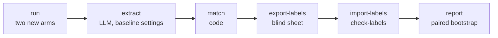

# v2 comparison

The v2 slice is measured against the v1 baseline on the article task, on the same 16 articles and the same frozen source texts. This page describes the harness; the protocol and its reasons are in [ADR-0010](../adr/0010-v2-comparison-protocol.md), and the choices of the harness in [ADR-0013](../adr/0013-v2-comparison-harness.md).

Code: [`evals/v2/compare/`](../../evals/v2/compare/). Committed data: `evals/datasets/v2_compare/` (labels, export log, report). Local data: `evals/.data/v2_compare/` (model outputs, elements, the sheet).

## Arms

| Arm | Prompt | Pipeline | Source of the outputs |
| --- | --- | --- | --- |
| `page_text` | `v1-frozen` | v1 prompt, model defaults | The baseline's runs, reused as they are |
| `plain_prompt` | `v1-plain-1` | Free text out, the editorial instructions and temperature of v2, no evidence ids, no validator | Generated by this harness |
| `v2` | `v2-article-1` | Evidence ids, structured output, validation, one retry, removal of failed quotes | Generated by this harness |

All arms use the same model and receive the same text: the frozen snapshot of the article, capped at 30,000 characters. One generation per article and arm.

The comparison answers two questions. `v2 − page_text` is the primary result: does the v2 slice state fewer unsupported elements than v1 given the same text? `plain_prompt` splits that difference in two: what a plain prompt with the same instructions wins (`plain_prompt − page_text`), and what the architecture adds beyond it (`v2 − plain_prompt`).

## Steps



| Step | Status | What it does |
| --- | --- | --- |
| `run` | Written | Runs `v2` then `plain_prompt` on each of the 16 articles. |
| `extract`, `match` | Planned | The baseline's extractor and matcher, on the plain output or the rendered v2 text. |
| `export-labels`, `import-labels`, `check-labels` | Planned | The blind sheet, its import into a labels file of its own, and three mechanical checks. |
| `report` | Planned | Rates per arm, paired differences with their intervals, guards, and the conclusion chosen by code. |

The harness reads the baseline's files and never writes them. The baseline command accepts only its own two conditions, `url_only` and `page_text`.

## The `run` step

```bash
uv run python -m evals.v2.compare run            # needs GEMINI_API_KEY
uv run python -m evals.v2.compare run --items tsa-00 --conditions v2
```

Before the first call, the step refuses to start when:

- a prompt differs from its pinned fingerprint (the prompts were frozen after the [tryout](v2-tryout.md));
- a snapshot text is missing or does not match its recorded hash;
- the model differs from the one of the baseline's `page_text` article runs.

A run is identified by article and arm (`<item_id>:<condition>:article:0`). The rules that keep "one generation per article":

- a generation that succeeded is never run again, and the step has no option to force it;
- a technical error (API, timeout) is recorded; running the step again retries it, and the error record stays in the file;
- a v2 generation that fails validation is a result: it is recorded, counted, and never retried.

Each record stores the model, the date, the prompt version and fingerprint, the settings sent, the hash of the input text, tokens and latency; for v2 also the outcome, each attempt with its issues, the quotes kept and removed, and the rendered text.

The step prints counters only, never model text: the person who labels must not read the outputs first. Its summary gives, per arm, the runs that succeeded, failed validation, hit a technical error or are missing. With more than two failed v2 generations it says that no headline comparison is published until the cause is understood (ADR-0010, point 12).

## Labeling

Every element of the three arms is labeled by hand, blind to the arm. The rules are in the [labeling guide](v2-labeling-guide.md), frozen before the first export.

## Results

None yet: the arms have not run on the sample.
