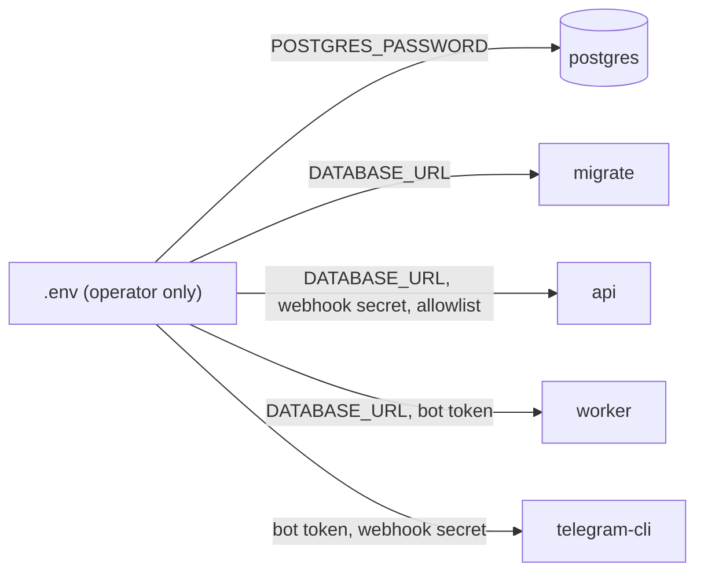

# Configuration reference

This page lists every environment variable the system reads, which process reads it, and how secrets are distributed between containers. The source of truth is [`src/dzdia_newsroom/config.py`](../../src/dzdia_newsroom/config.py) (typed `pydantic-settings` classes) and [`docker-compose.yml`](../../docker-compose.yml) (which variables each service receives).

## How settings are loaded

- Each process loads only the settings classes it needs: the API never instantiates the bot-token settings, and database commands never need an LLM key ([ADR-0005](../adr/0005-telegram-ingress.md)).
- Values come from the process environment. Outside Docker, a `.env` file in the working directory is also read (`env_file=".env"`).
- Unknown variables are ignored (`extra="ignore"`).
- Empty values are treated as unset (`env_ignore_empty=True`). Compose passes an absent optional variable as `""` (`${VAR:-}`), so the default applies instead of a parse error.
- In Docker, `.env` is only used by compose for interpolation. Each service lists the variables it receives in its `environment:` block; there is no shared `env_file:` ([ADR-0006](../adr/0006-docker-image-and-compose.md)).

## Variables

| Variable | Used by | Required | Default | Description and constraints |
|---|---|---|---|---|
| `POSTGRES_PASSWORD` | compose (`postgres`, and interpolated into `DATABASE_URL`) | Yes (compose refuses to start without it) | — | Password of the `dzdia` database user. Must be URL-safe: it is inserted as-is into `postgresql://dzdia:<password>@postgres:5432/dzdia`. |
| `DATABASE_URL` | `migrate`, `api`, `worker` (`DatabaseSettings`) | Yes | Built by compose | Postgres connection string. Set it yourself only when running processes outside compose. |
| `TELEGRAM_WEBHOOK_SECRET` | `api`, `telegram-cli` (`TelegramWebhookSettings`) | Yes | — | Shared secret Telegram sends in the `X-Telegram-Bot-Api-Secret-Token` header. 32 to 256 characters among `A-Z`, `a-z`, `0-9`, `_` and `-`; anything else fails validation at startup. |
| `TELEGRAM_ALLOWED_USER_IDS` | `api` (`TelegramWebhookSettings`) | No | empty | Comma-separated Telegram user ids, e.g. `123,456`. Empty means nobody is allowed (fail closed). |
| `TELEGRAM_TEAM_CHAT_ID` | `api` (`TelegramWebhookSettings`) | No | unset | Id of the team group. Allowed users are accepted in private chats and in this group only; unset means all groups are refused. |
| `TELEGRAM_BOT_TOKEN` | `worker`, `telegram-cli` (`TelegramBotSettings`) | Yes for these services | — | Bot API token from BotFather. Never given to the `api` service. |
| `LOG_FORMAT` | `api`, `worker`, `migrate` (`LoggingSettings`) | No | `json` | `json` (one object per line) or `text` (human-readable, for local development). |
| `LOG_LEVEL` | `api`, `worker`, `migrate` (`LoggingSettings`) | No | `INFO` | `DEBUG`, `INFO`, `WARNING` or `ERROR`. |
| `PUBLIC_HOST` | compose (`caddy`, profile `prod`) | Yes in production | empty | Public host name Caddy serves and gets a Let's Encrypt certificate for, e.g. `bot.dzdia.com`. |
| `API_PORT` | compose (`api` port mapping) | No | `8000` | Host port bound on `127.0.0.1` for the API. |
| `POSTGRES_PORT` | compose (`postgres` port mapping) | No | `5432` | Host port bound on `127.0.0.1` for Postgres. |
| `BACKUP_AGE_RECIPIENT` | `deploy/backup.sh` | Yes for backups | — | `age` public key (`age1...`) the dumps are encrypted to. Not a secret; the private key never goes on the VM ([ADR-0007](../adr/0007-production-host-on-oracle-cloud.md)). |
| `BACKUP_BUCKET` | `deploy/backup.sh` | Yes for uploads | — | Name of the Object Storage bucket, e.g. `dzdia-backups`. |
| `BACKUP_HEALTHCHECK_URL` | `deploy/backup.sh` | No | unset | healthchecks.io ping URL (`https://hc-ping.com/<uuid>`), pinged at the start, success or failure of daily runs. Treat it as a secret: anyone with it can send false pings. |
| `OCI_NAMESPACE` | compose (`rclone`, profile `ops`) | Yes for uploads | — | Object Storage namespace of the tenancy (console: Tenancy details). |
| `OCI_COMPARTMENT_OCID` | compose (`rclone`) | Yes for uploads | — | OCID of the compartment that holds the bucket. |
| `OCI_REGION` | compose (`rclone`) | Yes for uploads | — | Region identifier, e.g. `eu-marseille-1`. |
| `GEMINI_API_KEY` | eval harness (`Settings`) | Yes for `evals.baseline_v1` LLM steps | — | Google Gemini API key. Not passed to any compose service. |
| `V1_MODEL` | eval harness (`Settings`) | No | `gemini-3.1-flash-lite-preview` | Model used to replay the legacy v1 prompts. |
| `EXTRACTION_MODEL` | eval harness (`Settings`) | No | `gemini-2.5-flash` | Model used to extract critical elements. |
| `LLM_MAX_CONCURRENCY` | eval harness (`Settings`) | No | `2` | Maximum concurrent LLM calls in the eval harness. |

`migrate` reads `LOG_FORMAT` and `LOG_LEVEL` from its environment, but compose does not pass them to it today, so it uses the defaults.

## Generating secrets

Both commands produce 64 hexadecimal characters, which satisfy the webhook-secret pattern and are safe inside a URL:

```bash
openssl rand -hex 32   # TELEGRAM_WEBHOOK_SECRET
openssl rand -hex 32   # POSTGRES_PASSWORD
```

Do not use `@`, `/`, `:` or `?` in `POSTGRES_PASSWORD`: compose does not URL-encode it when it builds `DATABASE_URL`.

## Which service receives which secret

Least privilege ([ADR-0005](../adr/0005-telegram-ingress.md), [ADR-0006](../adr/0006-docker-image-and-compose.md)): a compromised API process cannot send messages as the bot, and the migration job cannot reach Telegram.

| Service | `DATABASE_URL` | `TELEGRAM_WEBHOOK_SECRET` | `TELEGRAM_BOT_TOKEN` | Allowlist |
|---|---|---|---|---|
| `postgres` | (owns `POSTGRES_PASSWORD`) | — | — | — |
| `migrate` | yes | — | — | — |
| `api` | yes | yes | **no** | yes |
| `worker` | yes | — | yes | — |
| `telegram-cli` (profile `tools`) | — | yes | yes | — |
| `caddy` (profile `prod`) | — | — | — | — |
| `cloudflared` (profile `dev`) | — | — | — | — |
| `rclone` (profile `ops`) | — | — | — | — |

`rclone` receives only the `OCI_*` identifiers, no credential: it authenticates as the VM's instance principal. `deploy/backup.sh` reads `BACKUP_*` from `.env` itself (it parses the file, it never sources it).



`telegram-cli` is the only service that gets both the token and the secret, because `setWebhook` needs both. It runs on demand and exits.

## Adding a variable

See [Conventions: adding an environment variable](../development/conventions.md#adding-an-environment-variable).
