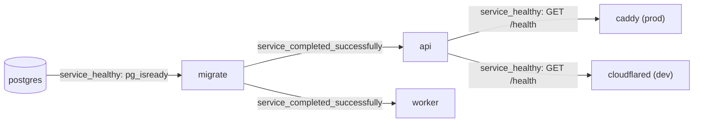
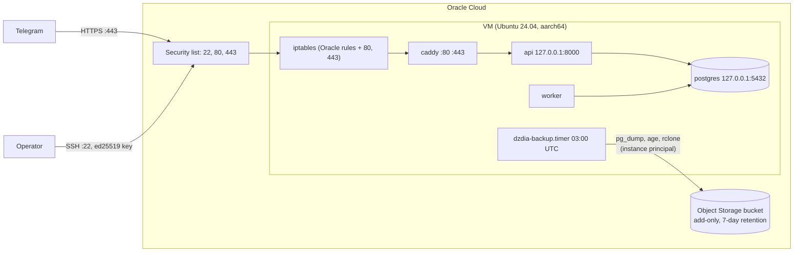

# Deployment

This page explains how to run the full stack with Docker Compose, locally (profile `dev`) and in production (profile `prod`, on the Oracle Cloud VM), and how to deploy, roll back and back up. The design is recorded in [ADR-0004](../adr/0004-runtime-foundation.md) (services and hosting), [ADR-0006](../adr/0006-docker-image-and-compose.md) (image, profiles, migrations, secrets) and [ADR-0007](../adr/0007-production-host-on-oracle-cloud.md) (production host, deployment, backups). Every variable is described in the [configuration reference](configuration.md).

## Services and profiles

| Service | Profile | Role |
|---|---|---|
| `postgres` | always | `pgvector/pgvector:0.8.7-pg16-bookworm` (pinned by digest), data in the `pgdata` volume, port bound to `127.0.0.1` |
| `migrate` | always | Applies pending SQL migrations once, then exits |
| `api` | always | FastAPI webhook receiver, port bound to `127.0.0.1` |
| `worker` | always | Executes jobs from the Postgres queue |
| `cloudflared` | `dev` | Quick tunnel: a public HTTPS URL to `api`, without an account |
| `caddy` | `prod` | Only public entry point (ports 80 and 443), automatic Let's Encrypt certificates |
| `telegram-cli` | `tools` | One-off Bot API commands (`set-webhook`, `webhook-info`) |
| `rclone` | `ops` | Uploads encrypted backups to Oracle Object Storage, run by `deploy/backup.sh` |

`api`, `worker`, `migrate` and `telegram-cli` share one image, built locally from the [`Dockerfile`](../../Dockerfile) (two stages, non-root user `app`, uid 10001).

## Startup order

Compose enforces this order with `depends_on` conditions. If a migration fails, neither `api` nor `worker` starts.



## Local stack (profile `dev`)

### Prerequisites

- Docker Desktop, started before any `docker` command. On Windows, Docker Desktop runs Linux containers through WSL 2.
- A development bot created with BotFather, and its token.
- A `.env` file at the repository root with at least `POSTGRES_PASSWORD`, `TELEGRAM_WEBHOOK_SECRET`, `TELEGRAM_BOT_TOKEN` and `TELEGRAM_ALLOWED_USER_IDS` (see [configuration](configuration.md)).

### Start

```bash
docker compose --profile dev up -d --build
```

The tunnel URL changes every time `cloudflared` starts. Read it from the logs (a `https://<random>.trycloudflare.com` line):

```bash
docker compose logs cloudflared
```

Register the webhook with that URL:

```bash
docker compose run --rm telegram-cli set-webhook --url https://<random>.trycloudflare.com/webhooks/telegram
```

The command only accepts `https://` URLs. Add `--drop-pending` to discard the updates Telegram kept while the webhook was unreachable.

### Check

```bash
docker compose ps
docker compose run --rm telegram-cli webhook-info
curl http://127.0.0.1:8000/health
```

`webhook-info` prints `url`, `pending_update_count`, `last_error_date` and `last_error_message`. Then send a text message to the bot from an allowed account: the worker replies "Bien reçu.".

### Stop

```bash
docker compose --profile dev down
```

The `pgdata` volume is kept. The webhook still points to the old tunnel URL; Telegram keeps undelivered updates for about 24 hours. Rerun `set-webhook` after the next start.

## Production (profile `prod`)

Production runs on one Oracle Cloud Ampere A1 VM (ARM64, Ubuntu 24.04). Every choice below is recorded in [ADR-0007](../adr/0007-production-host-on-oracle-cloud.md); the scripts live in [`deploy/`](../../deploy/).

### What runs where



- `caddy` is the only service listening on public ports (80 and 443). It serves `PUBLIC_HOST` with a certificate from Let's Encrypt, obtained and renewed automatically.
- The [`Caddyfile`](../../Caddyfile) forwards only `/webhooks/telegram` and `/health` to `api:8000`, and answers 404 to every other path. Request bodies above 1 MB are refused before they reach the API.
- `api` (`127.0.0.1:8000`) and `postgres` (`127.0.0.1:5432`) are bound to the loopback interface only. Postgres stays reachable for `psql` through an SSH tunnel.
- **Docker-published ports skip the host firewall** (they go through Docker's own chains, not `INPUT`). The loopback bindings are the real control, and [`tests/test_deploy_guards.py`](../../tests/test_deploy_guards.py) fails if any service other than `caddy` publishes a port on all interfaces.
- All services use `restart: unless-stopped` (except `migrate`), and `json-file` logs rotated at 10 MB × 5 files. Docker runs with `live-restore`.
- The image is built on the VM (native arm64). There is no registry.

| Path on the VM | Content |
|---|---|
| `/home/deploy/dzdia-newsroom` | The checkout (detached at the deployed commit) and its `.env` |
| `~deploy/.local/state/dzdia-newsroom/deployments.tsv` | Deployment history: time, action, commit, result |
| `/etc/ssh/sshd_config.d/10-dzdia.conf` | SSH restrictions |
| `/etc/iptables/rules.v4` (`.orig`: Oracle's original) | Host firewall loaded at boot |
| `/etc/apt/apt.conf.d/52dzdia-unattended-upgrades` | Docker origin and automatic reboot at 04:00 UTC |
| `/etc/docker/daemon.json` | `live-restore` and default log rotation |
| `/etc/systemd/system/dzdia-backup.{service,timer}` | Daily backup |

### First installation

#### 1. Oracle Cloud console (operator)

These steps act on the Oracle account, so the operator does them in the console:

1. **Upgrade the account to Pay As You Go** and create a **budget alert** (for example 1 €). Usage within the Always Free limits stays free, and the instance is no longer reclaimed when idle.
2. **Create the instance:** shape `VM.Standard.A1.Flex` (within the Always Free limits: 4 OCPU and 24 GB in total), image **Canonical Ubuntu 24.04** (aarch64), your **ed25519** public key (`ssh-keygen -t ed25519`; an RSA key would be refused by `bootstrap.sh`).
3. **Reserve the public IP** (Networking → Reserved public IPs) and assign it to the instance's VNIC, so the address never changes.
4. **Security list** of the subnet: inbound TCP 22, 80 and 443 from `0.0.0.0/0`, and ICMP type 3 code 4. Remove any other inbound rule.
5. **Backup bucket:** create a private bucket (for example `dzdia-backups`) with:
   - a **retention rule** of 7 days (objects cannot be deleted or overwritten during that time);
   - **lifecycle rules**: delete objects with prefix `daily/` and `predeploy/` after 8 days, and `weekly/` after 29 days. Lifecycle rules need the policy `Allow service objectstorage-<region> to manage object-family in compartment <compartment>`.
6. **Instance principal:** a dynamic group (for example `dzdia-vm`) whose matching rule is `instance.id = '<instance OCID>'`, and this policy:

   ```text
   Allow dynamic-group dzdia-vm to manage objects in compartment <compartment> where all {target.bucket.name = 'dzdia-backups', any {request.permission = 'OBJECT_INSPECT', request.permission = 'OBJECT_READ', request.permission = 'OBJECT_CREATE'}}
   ```

   No `OBJECT_OVERWRITE` and no `OBJECT_DELETE`: the VM can add backups, never remove them. Reading is harmless, since every object is encrypted.
7. **DuckDNS:** create a name and point it to the reserved IP (once: the IP is static, so no updater runs on the VM).
8. **healthchecks.io** (optional): a check with a daily period and a 1-hour grace time; keep its ping URL.

#### 2. Encryption key (operator, on the workstation)

```bash
age-keygen -o dzdia-backup.key
```

The command prints the public key (`age1...`): it goes into the VM's `.env`. The file `dzdia-backup.key` is the private key: store it in a password manager and on paper, **never on the VM**. Without it, the backups cannot be read.

#### 3. Provision the VM

```bash
ssh ubuntu@<reserved IP>
git clone https://github.com/Mounso/dzdia-newsroom.git /tmp/dzdia
sudo /tmp/dzdia/deploy/bootstrap.sh --dry-run   # read what it will change
sudo /tmp/dzdia/deploy/bootstrap.sh
```

[`bootstrap.sh`](../../deploy/bootstrap.sh) is idempotent: a second run changes nothing, and running it again after a change applies only the difference. It installs Docker from Docker's repository (key fingerprint checked), creates the `deploy` user (member of `docker`), restricts `sshd` to ed25519 keys for `ubuntu` and `deploy`, opens ports 80 and 443 in `iptables`, sets up `unattended-upgrades`, clones the repository into `/home/deploy/dzdia-newsroom` and enables the backup timer.

**Keep the current SSH session open** and check from another terminal that `ssh deploy@<reserved IP>` works before closing it. Then give `ubuntu` a console password (`sudo passwd ubuntu`, stored in the password manager): SSH refuses passwords, so it only works on the serial console from Oracle Cloud Shell, the recovery path if SSH is lost (see the [runbook](runbook.md#locked-out-of-ssh)).

#### 4. Production `.env`

As `deploy`, create `/home/deploy/dzdia-newsroom/.env` (mode 600) with the variables of the [configuration reference](configuration.md): the production bot's token (a bot separate from the development one), a new webhook secret and Postgres password, `PUBLIC_HOST`, the allowlist, and the backup variables (`BACKUP_AGE_RECIPIENT`, `BACKUP_BUCKET`, `OCI_NAMESPACE`, `OCI_COMPARTMENT_OCID`, `OCI_REGION`, optionally `BACKUP_HEALTHCHECK_URL`). Keep a copy of this file in the password manager: it is not part of the database backups, and a rebuilt VM needs it.

#### 5. First deployment and webhook

```bash
ssh deploy@<reserved IP>
cd dzdia-newsroom
deploy/deploy.sh origin/main
docker compose run --rm telegram-cli set-webhook --url https://$PUBLIC_HOST/webhooks/telegram --drop-pending
```

Replace `$PUBLIC_HOST` with the host name. `--drop-pending` discards updates sent before the bot existed. Then check the backup chain once by hand:

```bash
sudo systemctl start dzdia-backup.service    # as ubuntu
journalctl -u dzdia-backup.service -e
```

### Deploy a new version

```bash
ssh deploy@<reserved IP>
cd dzdia-newsroom
deploy/deploy.sh --dry-run origin/main   # optional: print the steps
deploy/deploy.sh origin/main
```

Check that the CI is green on the commit first: the VM has no GitHub token. [`deploy.sh`](../../deploy/deploy.sh) does, in order:

1. refuse a checkout with local changes, or a ref that is not on `origin/main`;
2. take a pre-deployment backup (`predeploy/`), unless no database runs yet;
3. check out the commit (detached), build the image, and tag it `dzdia-newsroom:<sha>` and `dzdia-newsroom:local`;
4. `docker compose --profile prod up -d --remove-orphans`: `migrate` runs first, then `api` and `worker` are recreated;
5. wait up to 120 s for `https://$PUBLIC_HOST/health` through Caddy, then print `webhook-info`;
6. record the result in `deployments.tsv`, and keep the images of the last 3 successful deployments.

On stop, the worker finishes its current job for up to 25 seconds (compose `stop_grace_period` is 30 seconds); a job cancelled after that is released back to the queue without losing an attempt, and the new worker takes it over. See the [runbook](runbook.md#worker-graceful-stop).

`dzdia-newsroom:local` always means "the deployed image" on the VM, so a manual `docker compose up -d <service>` from the runbook never rebuilds or runs another version. `set-webhook` is not part of a deployment: rerun it only when the host name or the secret changes.

### Roll back

```bash
deploy/deploy.sh --rollback   # previous successful deployment, no rebuild
deploy/deploy.sh --status     # current deployment and history
```

Rollback checks out the previous successful commit, points `dzdia-newsroom:local` back to its image and restarts the stack. The rolled-back commit is marked `reverted` and is never chosen again, unless it is deployed again. **The schema is never reverted**: this is safe only because every migration follows the expand/contract rule (see [conventions](../development/conventions.md#adding-a-migration)).

### Backups

A systemd timer runs [`deploy/backup.sh`](../../deploy/backup.sh) every day at 03:00 UTC:

1. `pg_dump -Fc` from the running `postgres` container;
2. **restore check**: the dump is restored into a throwaway Postgres (same image, no network, data in memory), and must have the same tables and applied migrations as the live database;
3. encryption with `age` to `BACKUP_AGE_RECIPIENT` (only the public key is on the VM), then deletion of the plain dump;
4. upload through the compose `rclone` service (profile `ops`) to `daily/` (and `weekly/` on Sundays), authenticated as the instance principal;
5. pings to `BACKUP_HEALTHCHECK_URL` (start, success or failure), if set.

| Prefix | Written | Kept |
|---|---|---|
| `daily/` | every day | 8 days (7 copies) |
| `weekly/` | Sundays | 29 days (4 copies) |
| `predeploy/` | before each deployment and rollback | 8 days |

Targets: at most 24 hours of data lost, and service back within about one hour on a new VM. The monthly restore drill and the full restore procedure are in the [runbook](runbook.md#backups-and-restore).

### Moving to `bot.dzdia.com`

1. Add an `A` record for `bot.dzdia.com` to the reserved IP.
2. Set `PUBLIC_HOST=bot.dzdia.com` in `.env`, then `docker compose --profile prod up -d caddy` (Caddy gets the new certificate).
3. `docker compose run --rm telegram-cli set-webhook --url https://bot.dzdia.com/webhooks/telegram`.
4. Delete the DuckDNS name.
