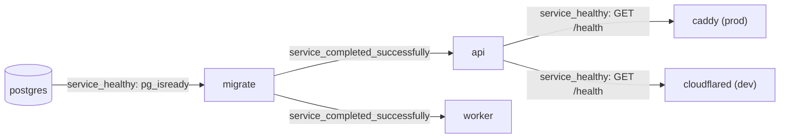

# Deployment

This page explains how to run the full stack with Docker Compose, locally (profile `dev`) and in production (profile `prod`), and how to upgrade a running deployment. The design is recorded in [ADR-0004](../adr/0004-runtime-foundation.md) (services and hosting) and [ADR-0006](../adr/0006-docker-image-and-compose.md) (image, profiles, migrations, secrets). Every variable is described in the [configuration reference](configuration.md).

## Services and profiles

| Service | Profile | Role |
|---|---|---|
| `postgres` | always | `pgvector/pgvector:pg16`, data in the `pgdata` volume, port bound to `127.0.0.1` |
| `migrate` | always | Applies pending SQL migrations once, then exits |
| `api` | always | FastAPI webhook receiver, port bound to `127.0.0.1` |
| `worker` | always | Executes jobs from the Postgres queue |
| `cloudflared` | `dev` | Quick tunnel: a public HTTPS URL to `api`, without an account |
| `caddy` | `prod` | Only public entry point (ports 80 and 443), automatic Let's Encrypt certificates |
| `telegram-cli` | `tools` | One-off Bot API commands (`set-webhook`, `webhook-info`) |

`api`, `worker`, `migrate` and `telegram-cli` share one image, built locally from the [`Dockerfile`](../../Dockerfile) (two stages, non-root user `app`, uid 10001).

## Startup order

Compose enforces this order with `depends_on` conditions. If a migration fails, neither `api` nor `worker` starts.



## Local stack (profile `dev`)

### Prerequisites

- Docker Desktop, started before any `docker` command. On Windows, Docker Desktop runs Linux containers through WSL 2.
- A development bot created with BotFather, and its token.
- A `.env` file at the repository root with at least `POSTGRES_PASSWORD`, `TELEGRAM_WEBHOOK_SECRET`, `TELEGRAM_BOT_TOKEN` and `TELEGRAM_ALLOWED_USER_IDS` (see [configuration](configuration.md)).

### Start

```bash
docker compose --profile dev up -d --build
```

The tunnel URL changes every time `cloudflared` starts. Read it from the logs (a `https://<random>.trycloudflare.com` line):

```bash
docker compose logs cloudflared
```

Register the webhook with that URL:

```bash
docker compose run --rm telegram-cli set-webhook --url https://<random>.trycloudflare.com/webhooks/telegram
```

The command only accepts `https://` URLs. Add `--drop-pending` to discard the updates Telegram kept while the webhook was unreachable.

### Check

```bash
docker compose ps
docker compose run --rm telegram-cli webhook-info
curl http://127.0.0.1:8000/health
```

`webhook-info` prints `url`, `pending_update_count`, `last_error_date` and `last_error_message`. Then send a text message to the bot from an allowed account: the worker replies "Bien reçu.".

### Stop

```bash
docker compose --profile dev down
```

The `pgdata` volume is kept. The webhook still points to the old tunnel URL; Telegram keeps undelivered updates for about 24 hours. Rerun `set-webhook` after the next start.

## Production (profile `prod`)

### What exists today

- `caddy` is the only service listening on public ports (80 and 443). It serves `PUBLIC_HOST` with a certificate from Let's Encrypt, obtained and renewed automatically.
- The [`Caddyfile`](../../Caddyfile) forwards only `/webhooks/telegram` and `/health` to `api:8000`, and answers 404 to every other path. Request bodies above 1 MB are refused before they reach the API.
- `api` (`127.0.0.1:8000`) and `postgres` (`127.0.0.1:5432`) are bound to the loopback interface only. Postgres stays reachable for `psql` through an SSH tunnel.
- All services use `restart: unless-stopped` (except `migrate`), and `json-file` logs rotated at 10 MB × 5 files.
- The image is built on the host that runs it (`docker compose build`), on amd64 or arm64. There is no registry.

### Start

```bash
docker compose --profile prod up -d --build
docker compose run --rm telegram-cli set-webhook --url https://$PUBLIC_HOST/webhooks/telegram
```

`set-webhook` is idempotent: running it at every deployment is safe.

### Planned — to be decided in ADR-0007

The following items are not implemented or decided yet:

- provisioning of the Oracle Cloud Ampere A1 VM (ARM64), with a GCP e2-micro fallback mentioned in [ADR-0004](../adr/0004-runtime-foundation.md);
- firewall rules (Oracle security lists and the host firewall);
- SSH hardening (key-only access, non-root user);
- Postgres backups (`pg_dump`): frequency, destination and retention, plus the restore procedure;
- a DuckDNS host name until a `dzdia.com` subdomain (for example `bot.dzdia.com`) is available.

## Upgrade

The current procedure, run on the host:

```bash
git pull
docker compose --profile prod up -d --build
```

Compose rebuilds the image, runs `migrate` again (already-applied migrations are skipped, see `schema_migrations`), then recreates `api` and `worker`. On stop, the worker finishes its current job for up to 25 seconds (compose `stop_grace_period` is 30 seconds); a job cancelled after that is released back to the queue without losing an attempt, and the new worker takes it over. See the [runbook](runbook.md#worker-graceful-stop).
